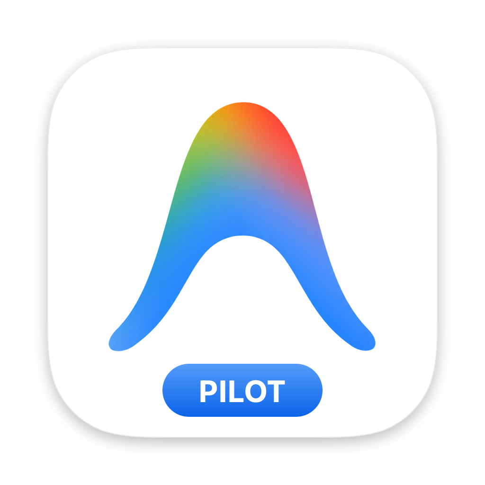

# Antigravity Pilot for macOS

<p align="center">
  
</p>

<p align="center">
  <a href="README.md">简体中文</a> | <strong>English</strong>
</p>

A 100% native macOS proxy launcher and telemetry companion for Antigravity, routing traffic through your local proxy without enabling Clash TUN mode while providing live context window, model quota, and token usage insights.

Key highlights of **Antigravity Pilot for macOS**:

- **macOS 13.0 (Ventura) or later support** (aligned with modern Antigravity `2.35+` requirements) with **Universal (`arm64` + `x86_64`)** builds, **4-language UI** (`简体中文` / `繁體中文` / `English` / `Русский`), and `./build.sh --dmg` packaging.
- **Three-channel No-TUN proxy & LAN CIDR bypass**: `libantigravity_proxy.dylib` (`__DATA,__interpose` Hook + `NO_PROXY` domain/CIDR bypass) + Go/Node environment variables (including `NODE_USE_ENV_PROXY=1`) + primary Chromium `--proxy-server` / `--proxy-bypass-list`.
- **Three-stage proxy health diagnostics & conflict protection**: Live probe of **TCP port → SOCKS5 handshake → `generate_204` internet latency**, plus `NSRunningApplication` conflict detection with one-click graceful quit.
- **0.1s fast hot-update & dynamic Entitlements**: Port, scheme, or `NO_PROXY` edits write to an external `proxy.env` without copying or re-signing the Runtime bundle; full rebuilds dynamically extract and merge entitlements from `/Applications/Antigravity.app`.
- **Single-layer flat Runtime `.app` & single Dock icon**: `AntigravityProxyLauncher` calls `execv()` in-place for single-icon Dock pinning; closing the main window tucks the monitor into the macOS menu bar (`.accessory` policy, zero extra Dock icon).
- **100% Native SwiftUI Monitor & Usage Companion (Zero JS injection, zero CDP)**:
  - Queries local `~/.gemini/antigravity/daemon/hub_*.json` via Connect-RPC for **live context composition, TTFT/generation speed, shared model quota pools, and reset countdowns**;
  - Incrementally scans `~/.gemini/antigravity/brain/*/.system_generated/logs/transcript.jsonl` to render a **20-week SwiftUI `Canvas` token heatmap, `Swift Charts` daily trends, and estimated API cost breakdown**;
  - Includes an `NSStatusBar` menu bar item + Popover and `SMAppService` native login item toggle.
- **Antigravity In-App Dashboard Plugin (Official MCP Apps / SEP-1865)**:
  - One-click install/update/uninstall to `~/.gemini/config/plugins/antigravity-pilot/` with zero JS injection, automatic light/dark theme sync, and compatibility with both original Antigravity and Pilot runtime;
  - Opens **Pilot Usage & Billing** as a full-screen view in the left sidebar or **Pilot Live Monitor** from the chat **`+`** menu, showing 3-stage proxy health, live context, quota pools, and a 1-year (52-week) usage & billing heatmap.
- **Icon switching & ASAR integrity**: Toggle between the **Default Pilot Icon** and **Original Icon** (with LaunchServices/Dock cache refresh), preserving 4-byte Pickle alignment and `ElectronAsarIntegrity`.

---

## Table of Contents

- [Introduction](#introduction)
- [Quick Start](#quick-start)
- [Icon Switching & Custom Icons](#icon-switching--custom-icons)
- [Update Antigravity](#update-antigravity)
- [Stop Background Processes](#stop-background-processes)
- [Uninstall](#uninstall)
- [How It Works](#how-it-works)
- [Build from Source](#build-from-source)
- [Local Test](#local-test)
- [Troubleshooting](#troubleshooting)
- [Limitations](#limitations)
- [Credits](#credits)
- [License](#license)

---

## Introduction

Releases distribute a lightweight native `Antigravity Pilot.app` companion and runtime builder. It **does not include** Google's original `Antigravity.app`.

System requirements & architectures:

- **macOS 13.0 (Ventura) or later**
- **Apple Silicon (`arm64`) and Intel (`x86_64`)** Universal binary
- **Xcode Command Line Tools** (used when generating/refreshing the local runtime copy to ad-hoc re-sign the bundle; run `xcode-select --install` if not installed yet)

When you configure and launch from Antigravity Pilot, it:

1. Runs a three-stage proxy diagnostic (TCP reachability → SOCKS5 handshake → `generate_204` internet latency).
2. Atomically writes your settings to an external `~/Library/Application Support/Antigravity Pilot/proxy.env`. If a matching, validly signed Runtime copy already exists, it **hot-updates and launches in ~0.1s** without copying the bundle again.
3. On initial build or when rebuilding is needed, copies `/Applications/Antigravity.app` into a single-layer bundle at `~/Library/Application Support/Antigravity Pilot/Runtime/Antigravity-Pilot.app`, installs `AntigravityProxyLauncher`, `libantigravity_proxy.dylib`, and `proxy.env`, patches the `PILOT` icon & `app.asar` (syncing `ElectronAsarIntegrity`), and ad-hoc re-signs with merged entitlements extracted from the original app.
4. Launches the proxied Antigravity while tucking the companion into your menu bar for live context, quota, and usage tracking—keeping only a single running Antigravity icon in your Dock.

> The original `/Applications/Antigravity.app` remains untouched.

---

## Quick Start

### Step 1: Install the original Antigravity

Ensure the original Antigravity app is installed at:

```text
/Applications/Antigravity.app
```

### Step 2: Download and install Antigravity Pilot.app

Download `Antigravity-Pilot-v0.1.0-macOS13-universal.dmg` from this repository's [Releases](https://github.com/TakeshiKaneshivo/antigravity-pilot-macos/releases) page (or build it yourself via [Build from Source](#build-from-source)), open the DMG, and drag `Antigravity Pilot.app` into `Applications`.

> **Note**: Because the app is ad-hoc signed and not notarized by Apple, if macOS reports **"is damaged and can't be opened"** or **"cannot be verified"** on first launch, clear the quarantine attribute in Terminal:
>
> ```bash
> xattr -cr "/Applications/Antigravity Pilot.app"
> ```

### Step 3: Open Antigravity Pilot, configure proxy, and launch

Opening `/Applications/Antigravity Pilot.app` reveals five native sidebar views: **Proxy Overview**, **Live Monitor**, **Usage & Billing**, **In-App Plugin**, and **Settings**.

#### Case A: Your Clash port is 7890

If you use Clash Verge's default mixed port `7890`:

- Host: `127.0.0.1`
- SOCKS5 Port: `7890`
- Env Proxy Scheme: `http`
- Env Proxy Port: `7890`
- App Icon: choose **Default Pilot Icon** (with `PILOT` badge) or **Original Icon**
- Advanced Settings: customize `NO_PROXY` bypass rules (private LAN CIDRs and `*.local` are bypassed by default), menu bar monitor, and login item autostart

Click **Rebuild & Launch** (or **Save & Fast Launch**).

#### Case B: Your Clash port is not 7890

If you use another mixed port, such as `7893`:

- Host: `127.0.0.1`
- SOCKS5 Port: `7893`
- Env Proxy Scheme: `http`
- Env Proxy Port: `7893`

If you use a dedicated SOCKS5 port, such as `7891`:

- Host: `127.0.0.1`
- SOCKS5 Port: `7891`
- Env Proxy Scheme: `socks5`
- Env Proxy Port: `7891`

### Step 4: Pin to Dock & Menu Bar Companion

1. Once the proxied Antigravity opens, right-click its running icon in the Dock → **Options → Keep in Dock** (you can unpin the original Antigravity icon so you don't launch it by mistake).
2. Closing the Antigravity Pilot window switches it to `.accessory` mode (zero extra Dock icon) while keeping a live status pill (e.g. `188K · 89%`) in the macOS menu bar.
3. Settings are saved in `~/Library/Application Support/Antigravity Pilot/config.json`.

---

## Icon Switching & Custom Icons

### Switching between Default Pilot Icon and Original Icon

In the **App Icon** row of Antigravity Pilot:

- **Default Pilot Icon**: Applies the bundled `PILOT`-badged icon to the Runtime app, helpers, and `app.asar` so it is visually distinct from the original app in the Dock.
- **Original Icon**: Preserves the crisp flat `icon.icns`, helper icons, and unmodified `app.asar`, while removing `CFBundleIconName` (keeping `Assets.car` on disk so Electron does not override the Dock icon at runtime). *(Note: `/Applications/Antigravity Pilot.app` itself keeps the `PILOT` icon.)*

### Using your own custom PNG icon

1. Replace `icon.png` in the repository root with your PNG image (recommended HIG layout: `1024×1024` transparent canvas, `824×824` centered squircle, `100 px` padding).
2. Run `./build.sh`.

---

## Update Antigravity

When `/Applications/Antigravity.app` updates, launching the Runtime copy from the Dock displays a notification banner and a 4-second auto-closing alert if a version mismatch is detected:

1. Update `/Applications/Antigravity.app` first and quit any running Antigravity instance.
2. Open `/Applications/Antigravity Pilot.app` (or use the one-click **Graceful Quit & Rebuild** banner) to refresh the Runtime copy in place without losing your Dock pin.

---

## Stop Background Processes

Quitting from the menu bar (`Cmd + Q`) normally closes everything cleanly. To stop any lingering background processes manually:

```bash
./stop-antigravity-proxy.sh
```

This script stops both current `Antigravity Pilot` runtime processes and legacy `Antigravity Proxy` / local dev copies.

---

## Uninstall

1. If installed, uninstall the in-app dashboard plugin from the **In-App Plugin** view (or remove `~/.gemini/config/plugins/antigravity-pilot`).
2. Quit Antigravity and the Antigravity Pilot menu bar item.
3. Unpin the Runtime icon from the Dock and delete `/Applications/Antigravity Pilot.app`.
4. Remove runtime copies, plugin files, and saved settings:

```bash
rm -rf "$HOME/Library/Application Support/Antigravity Pilot"
rm -rf "$HOME/Library/Application Support/Antigravity Proxy"
rm -rf "$HOME/.gemini/config/plugins/antigravity-pilot"
```

The original `/Applications/Antigravity.app` remains untouched.

---

## How It Works

### Why Not Inject Directly Into the Original App

Google's original `/Applications/Antigravity.app` on macOS is signed with **Hardened Runtime** and lacks `com.apple.security.cs.allow-dyld-environment-variables`, so macOS ignores `DYLD_INSERT_LIBRARIES`. Antigravity Pilot leaves the original bundle untouched and generates a locally re-signed single-layer Runtime copy with merged entitlements extracted from the original app.

### Single-Layer Architecture, Three-Channel Proxy & Native Telemetry

- **Single-Layer Runtime & Fast Hot-Update**: `AntigravityProxyLauncher` sits beside `Antigravity` inside `Runtime/Antigravity-Pilot.app/Contents/MacOS/`, prioritizes external `~/Library/Application Support/Antigravity Pilot/proxy.env` (preserving the bundle's `AG_SOURCE_VERSION`), and calls `execv()` in-place so only one Dock icon appears.
- **Three-Channel Proxy Interception**:
  1. **`libantigravity_proxy.dylib` (`__DATA,__interpose`)**: Hooks `getaddrinfo()` / `freeaddrinfo()` (safely distinguishing dylib-allocated nodes from system allocations via `owned_ai_ptrs`) and `connect()`. Assigns `198.18.0.0/15` FakeIPs for external hostnames and routes via SOCKS5 domain `CONNECT`, while bypassing `NO_PROXY` domain suffixes and private LAN CIDRs directly.
  2. **Environment Variables**: Exports `HTTP_PROXY`, `HTTPS_PROXY`, `ALL_PROXY`, `NO_PROXY`, and `NODE_USE_ENV_PROXY=1` for `language_server` (Go) and Node 22+ `fetch`.
  3. **Primary Chromium Flags**: Appends `--proxy-server` and `--proxy-bypass-list` to the primary Chromium process (omitted for `ELECTRON_RUN_AS_NODE` and `--type=` subprocesses).
- **100% Native Telemetry (Zero JS Injection, Zero CDP)**:
  - Discovers live `~/.gemini/antigravity/daemon/hub_*.json` instances and queries loopback Connect-RPC (`GetUserStatus`, `GetAllCascadeTrajectories`, `GetCascadeTrajectoryGeneratorMetadata`) using a proxy-free `URLSession`.
  - Incrementally scans `~/.gemini/antigravity/brain/*/.system_generated/logs/transcript.jsonl` into `usage_cache.json` to render the 20-week `Canvas` heatmap, `Swift Charts` daily bars, and estimated API cost breakdown.

---

## Build from Source

Xcode Command Line Tools are required:

```bash
xcode-select --install
```

Build **macOS 13.0+ Universal (`arm64` + `x86_64`)** binaries:

```bash
./build.sh
```

Rebuild the MCP web dashboard and package a distributable `.dmg` installer (printing its SHA256):

```bash
./build.sh --build-web --dmg
```

Override defaults (`APP_VERSION=0.1.0`, `MIN_MACOS=13.0`, `ARCHS="arm64 x86_64"`):

```bash
APP_VERSION=0.1.0 MIN_MACOS=14.0 ARCHS=arm64 ./build.sh --dmg
```

Build outputs:

```text
build/Antigravity Pilot.app
build/Antigravity-Pilot-v0.1.0-macOS13-universal.dmg   # when --dmg is passed
build/antigravity-pilot-mcp
build/libantigravity_proxy.dylib
build/AntigravityProxyLauncher
build/test_client
```

Run the non-UI native smoke test against the compiled app:

```bash
"build/Antigravity Pilot.app/Contents/MacOS/AntigravityProxyBuilder" --smoke-test
```

---

## Local Test

Verify FakeIP allocation and SOCKS5 `CONNECT` forwarding:

```bash
./build.sh
./tests/socks5_capture.py 18081
```

In another terminal:

```bash
AG_PROXY=socks5://127.0.0.1:18081 \
AG_PROXY_LOG=1 \
DYLD_INSERT_LIBRARIES="$PWD/build/libantigravity_proxy.dylib" \
./build/test_client login.example.test 443
```

When working properly, the SOCKS5 capture server outputs:

```text
captured login.example.test:443
```

---

## Troubleshooting

### macOS reports "is damaged" or "cannot be verified"

```bash
xattr -cr "/Applications/Antigravity Pilot.app"
```

### Prompted to install Xcode Command Line Developer Tools

```bash
xcode-select --install
```

### Health badge reports "Non-SOCKS5 Port" or "Internet Unreachable"

- **Non-SOCKS5 Port**: The configured port returned an HTTP response instead of a SOCKS5 greeting (`05 00`). Use a Clash mixed port (e.g. `7890`) or dedicated SOCKS5 port.
- **Internet Unreachable**: Your local proxy port is listening, but the tunneled request to `www.google.com/generate_204` failed. Check your proxy node/routing rules.

### Switching between Original Icon and Default Pilot Icon

- Toggling the icon automatically refreshes LaunchServices and restarts the Dock.
- The toggle applies to the **Runtime app** (`~/Library/Application Support/Antigravity Pilot/Runtime/Antigravity-Pilot.app`), while `/Applications/Antigravity Pilot.app` always keeps the `PILOT` icon.

### Original Antigravity will not open

Do not run the original and Pilot versions concurrently (they share the same Electron user data directory and single-instance lock). Use the **Graceful Quit & Launch** banner inside Antigravity Pilot to switch cleanly.

---

## Limitations

- The dylib hook only intercepts TCP `connect()` (not UDP/QUIC) and currently supports unauthenticated SOCKS5 proxies.
- Numeric IP addresses (e.g. `127.0.0.1`) are recommended for the proxy host.
- Initial Runtime generation copies the full Antigravity bundle and takes a few seconds; subsequent port/scheme/`NO_PROXY` edits hot-update in ~0.1s, and Dock launches start immediately.
- Historical billing figures are estimates based on public reference API pricing (customizable via `~/Library/Application Support/Antigravity Pilot/custom_pricing.json`), not actual subscription charges.
- `Antigravity Pilot.app` is ad-hoc signed; Developer ID signing and notarization are recommended for wider distribution.

---

## Credits

- [OkamiFeng/mac-antigravity-proxy-dylib](https://github.com/OkamiFeng/mac-antigravity-proxy-dylib): Antigravity Pilot originally evolved from an early version of this project. Thanks to the original author for the pioneering macOS dylib proxy injection and re-signing workflow.
- [yuaotian/antigravity-proxy](https://github.com/yuaotian/antigravity-proxy): Inspired the network hooking approach (Windows DLL injection vs. `DYLD_INSERT_LIBRARIES` dylib injection on macOS).

---

## License

MIT License. See [LICENSE](LICENSE).
