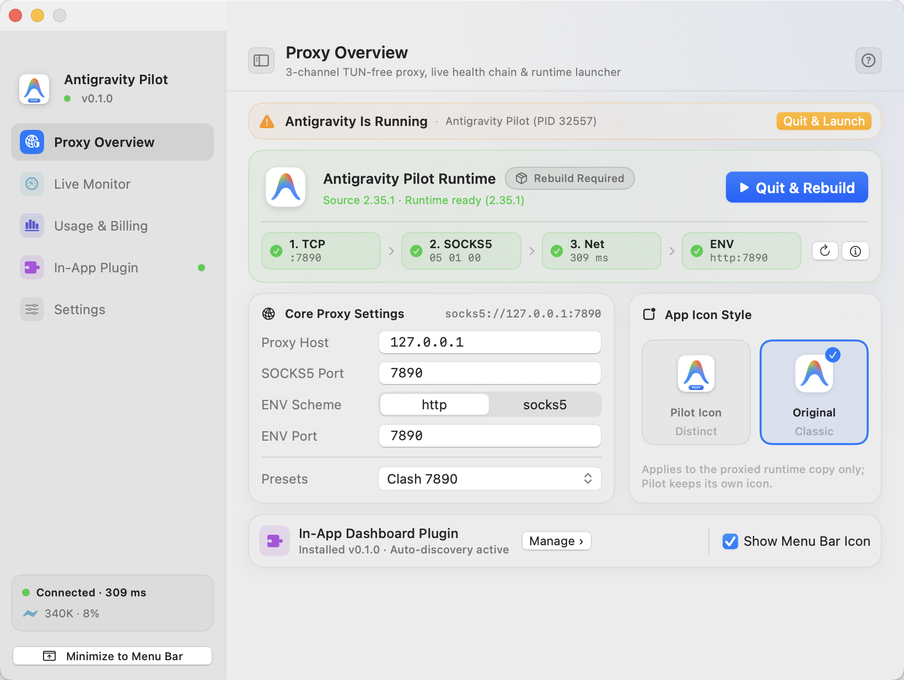
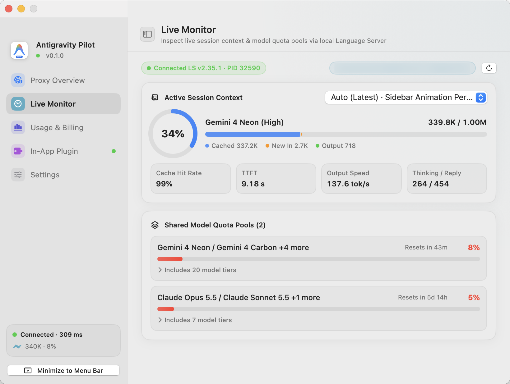
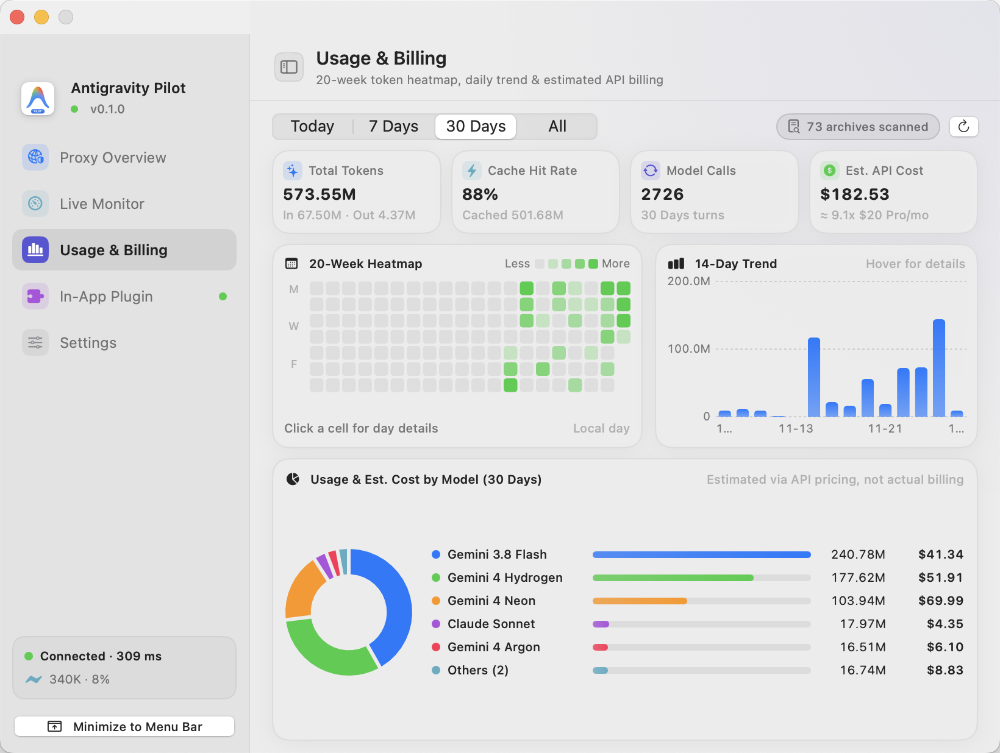
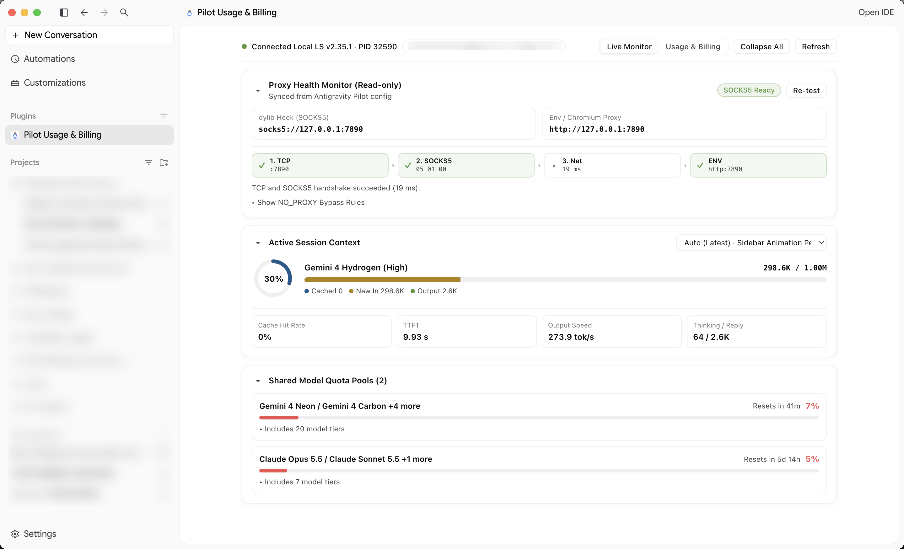
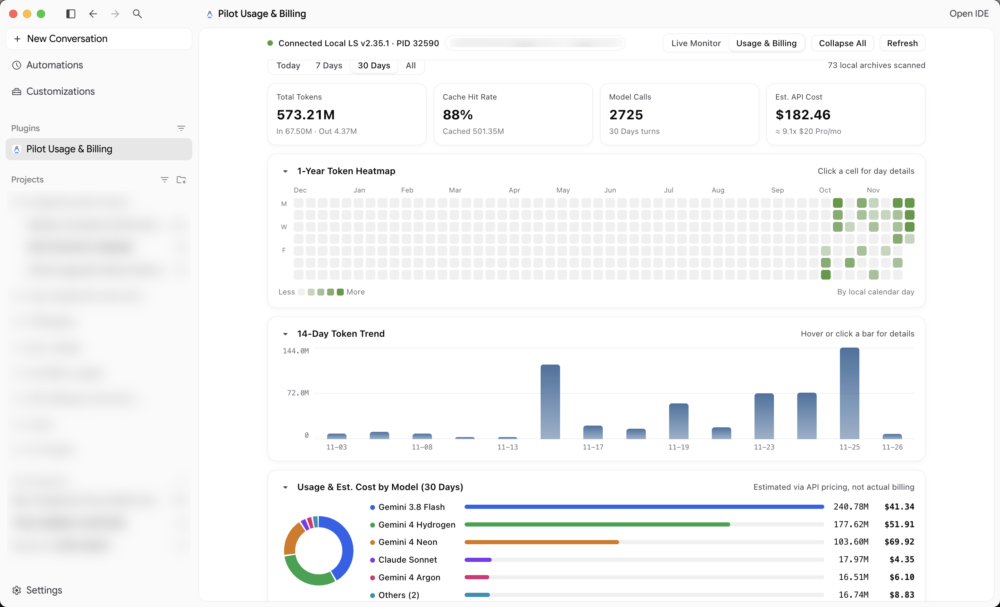

# Antigravity Pilot for macOS

<p align="center">
  
</p>

<p align="center">
  
  
  
  
</p>

<p align="center">
  <a href="README.md">简体中文</a> | <a href="README.zh-Hant.md">繁體中文</a> | <strong>English</strong> | <a href="README.ru.md">Русский</a>
</p>

A **zero-intrusion**, 100% native macOS companion for Antigravity. Route Antigravity through your local proxy without enabling Clash TUN mode or modifying `/Applications/Antigravity.app`, while getting native live context monitoring, shared quota pools, token usage billing, and an official in-app dashboard.

---

## Screenshots

<table>
  <tr>
    <td align="center" width="33.3%">
      
      <br><sub>Proxy Overview (3-Stage Health & Hot Update)</sub>
    </td>
    <td align="center" width="33.3%">
      
      <br><sub>Live Monitor (Context Gauge & Quota Pools)</sub>
    </td>
    <td align="center" width="33.3%">
      
      <br><sub>Usage & Billing (20-Week Heatmap & Cost)</sub>
    </td>
  </tr>
</table>

<table>
  <tr>
    <td align="center" width="50%">
      
      <br><sub>In-App MCP Dashboard · Live Monitor (Proxy Probe & Context / Quotas)</sub>
    </td>
    <td align="center" width="50%">
      
      <br><sub>In-App MCP Dashboard · Usage & Billing (1-Year Heatmap & Cost)</sub>
    </td>
  </tr>
</table>

---

## Zero-Intrusion Design

| Dimension | Antigravity Pilot for macOS |
| :--- | :--- |
| **Original App** | `/Applications/Antigravity.app` stays **read-only with zero injection**; only replaced atomically with a verified official Google-signed bundle if you click **Update & Rebuild** |
| **Proxy Routing** | **No-TUN Targeted Routing**: Proxies only Antigravity and its helpers while bypassing LAN CIDRs directly |
| **Telemetry** | **Zero JS Injection, Zero CDP**: Native SwiftUI reads local daemon RPC and transcript logs |
| **In-App Dashboard** | **Official MCP Apps (SEP-1865)**: Installed in user plugin space; works in both Original and Pilot |
| **Uninstall** | Isolated under `~/Library/Application Support/Antigravity Pilot/` and `~/.gemini/config/plugins/antigravity-pilot/` for a clean rollback |

---

## Key Features

- **No-TUN Local Proxy & 0.1s Hot-Update**: Routes Antigravity through your local SOCKS5/HTTP proxy via an isolated copy (7 presets, IPv4/IPv6, `NO_PROXY` LAN bypass), with instant port edits without rebuilding.
- **3-Stage Health Check & Conflict Guard**: Live probe for TCP reachability, SOCKS5 handshake, and `generate_204` latency; validates the proxy before prompting and gracefully quitting running instances.
- **100% Native Live Monitor**: Tracks context breakdown & step hierarchy, TTFT, generation speed, and dual-window (`5h` / `7d`) quota pools with Auto-Latest or pinned sessions.
- **Usage Heatmap, Efficiency & Cost Ranking**: 20-week heatmap, 14-day trend, Desktop + CLI attribution, cache savings & `>200K` tiered premium analysis, and Cost (`$`) / Token ranking across Model / Project / Session views (synced with 4 Morandi palettes to the in-app dashboard).
- **Long-Task Guardian & System Notifications**: 4 independent toggles in **Settings** (all on by default): automatic IOKit idle-sleep prevention while sessions run (display may sleep), task complete/error, input/approval needed, and quota pool recovery alerts via instant `hooks.json` + polling fallback.
- **Menu Bar Companion & In-App Plugin**: Minimizes to the menu bar (customizable spinner, context, and `5h`/`7d` quota), sends native update alerts, and embeds a 0-token in-app dashboard.
- **In-App Auto-Update & 4 Languages**: Direct/proxy SHA-256 self-updates, 3 copy icon styles (Badged / Original / Pilot), and 4-language UI (`简体中文` / `繁體中文` / `English` / `Русский`).

---

## Table of Contents

- [Screenshots](#screenshots)
- [Zero-Intrusion Design](#zero-intrusion-design)
- [Key Features](#key-features)
- [Quick Start](#quick-start)
- [Daily Usage & Maintenance](#daily-usage--maintenance)
- [How It Works](#how-it-works)
- [Build from Source & Local Test](#build-from-source--local-test)
- [Troubleshooting](#troubleshooting)
- [Limitations](#limitations)
- [Credits & License](#credits--license)
- [Contact](#contact)

---

## Quick Start

### System Requirements

- **macOS 13.0 (Ventura) or later** (Apple Silicon `arm64` and Intel `x86_64` Universal)
- **Xcode Command Line Tools** (used for local `codesign` when creating/rebuilding the proxy copy; run `xcode-select --install` if needed)
- Original **`/Applications/Antigravity.app`** installed (Releases do not bundle Google's app)

### Step 1: Download and Install Antigravity Pilot.app

**Option A: One-line installer (recommended — verifies SHA-256 and avoids Gatekeeper quarantine prompts)**

```bash
curl -fsSL https://raw.githubusercontent.com/TakeshiKaneshivo/antigravity-pilot-macos/main/install.sh | bash
```

**Option B: Manual DMG download**

Download `Antigravity-Pilot-v0.2.1-macOS13-universal.dmg` from [Releases](https://github.com/TakeshiKaneshivo/antigravity-pilot-macos/releases) (or see [Build from Source & Local Test](#build-from-source--local-test)), open the DMG, and drag `Antigravity Pilot.app` into `Applications`.

> **Note**: Because the app is ad-hoc signed, if macOS reports **"is damaged and can't be opened"** or **"cannot be verified"** after a browser download, use Option A or clear quarantine in Terminal:
>
> ```bash
> xattr -cr "/Applications/Antigravity Pilot.app"
> ```

### Step 2: Pick a Proxy Preset and Launch

Open `/Applications/Antigravity Pilot.app` to access five native tabs: **Proxy Overview**, **Live Monitor**, **Usage & Billing**, **In-App Plugin**, and **Settings**.

1. Under **Core Proxy Settings → Presets**, pick your proxy client (`Clash 7890`, `Verge 7897`, `Clash 7891`, `Surge 6153`, `v2ray 10808`, `Sing-box 12334`, or `SOCKS 1080`), or enter a custom Host, SOCKS5 port, and ENV scheme/port.
2. Once the 3-stage health chain turns green, click **Build & Launch** (or **Save & Quick Launch** when a matching copy exists) at the **top-right** of the hero card.

### Step 3: Single-Icon Dock Launch & Menu Bar Companion

1. Once the proxied Antigravity opens, right-click its running Dock icon → **Options → Keep in Dock** (unpin the original icon to avoid launching it by mistake).
2. Closing `Antigravity Pilot` minimizes it to the menu bar (keeping only Antigravity in the Dock), showing compact metrics like `② 148K · 5h 39%` (customizable in **Settings**) with a quick popover.
3. Configuration is saved at `~/Library/Application Support/Antigravity Pilot/config.json`.

---

## Daily Usage & Maintenance

### Icon Switching & Custom Icons

- **Built-in Styles**: Switch anytime between **Badged (Rec.)**, **Original**, and **Pilot** in **App Icon Style** (applies only to the proxy copy; `/Applications/Antigravity Pilot.app` always keeps the `PILOT` icon).
- **Custom PNG Icon**: Replace `icon.png` (recommended `1024×1024` transparent canvas, `824×824` centered squircle, `100 px` padding) or `menubar-icon.png` (monochrome menu bar icon) in the repo root and run `./build.sh`.

### Updating Pilot & Original Antigravity

- **Updating Antigravity Pilot**: Click the version badge at the bottom of the sidebar to check GitHub Releases, download the DMG over direct/proxy routes, verify SHA-256, and update in place.
- **Updating Original `/Applications/Antigravity.app`**: The copy disables Squirrel's failing updater; instead, Pilot checks Google's feed over your proxy. Click **Update & Rebuild** to verify SHA-512 + Google's signature and atomically update & rebuild; Pilot also sends native macOS notifications whenever the original app updates.

### Stop Background Processes

Quitting via `Cmd + Q` or the menu bar normally exits cleanly. To stop any lingering processes (including Helpers):

```bash
./stop-antigravity-proxy.sh
```

### Uninstall

1. If installed, click **Uninstall** on the **In-App Plugin** tab.
2. Quit Antigravity and the Antigravity Pilot menu bar item, unpin the Dock icon, and delete `/Applications/Antigravity Pilot.app`.
3. Remove isolated user-space directories (original `/Applications/Antigravity.app` stays completely untouched):

```bash
rm -rf "$HOME/Library/Application Support/Antigravity Pilot"
rm -rf "$HOME/Library/Application Support/Antigravity Proxy"
rm -rf "$HOME/.gemini/config/plugins/antigravity-pilot"
```

---

## How It Works

1. **Zero-Intrusion Isolated Copy**: `/Applications/Antigravity.app` uses Hardened Runtime and blocks external dylib injection, so Pilot keeps it read-only and creates an isolated user-space runtime copy with merged entitlements and local ad-hoc re-signing.
2. **Three-Channel No-TUN Proxy**: `libantigravity_proxy.dylib` (`__DATA,__interpose` + `198.18.0.0/15` FakeIP over SOCKS5), Go/Node env vars, and primary Chromium `--proxy-server` flags work together while bypassing LAN CIDRs via `NO_PROXY`.
3. **0.1s Hot-Update & Single Dock Icon**: `AntigravityProxyLauncher` reads external `proxy.env` and replaces itself via `execv()`, so port edits only rewrite config without re-signing, while source SHA-256 hashes prevent false rebuilds after ad-hoc `codesign`.
4. **Native Live Telemetry**: Discovers `~/.gemini/antigravity/daemon/hub_*.json` and queries proxy-free loopback Connect-RPC for context usage, performance metrics, and shared quota pools.
5. **Incremental Usage & Cost Estimates**: Incrementally scans Desktop + CLI session logs into `usage_cache.json` by `size + mtime` and computes API costs, cache savings, and `>200K` tiered premiums via auto-synced `pricing-catalog.json` (overridable via `custom_pricing.json`).
6. **Official In-App Dashboard, Hooks & ASAR Sync**: Serves a zero-JS, 0-token-refresh dashboard via official MCP Apps (SEP-1865) alongside native lifecycle `hooks.json` for instant task alerts, and updates `app.asar` + `ElectronAsarIntegrity` with 4-byte Chromium Pickle alignment when applying the Pilot icon.

---

## Build from Source & Local Test

### Build & Package

Xcode Command Line Tools are required (`xcode-select --install`):

```bash
# Build macOS 13.0+ Universal (arm64 + x86_64) app & native binaries (incremental build/.cache enabled)
./build.sh

# Fast incremental build for the host architecture only during local development
./build.sh --native

# Typecheck web dashboard, rebuild HTML bundle, and package .dmg + latest.json (prints SHA256)
npm --prefix src/McpAppWeb run typecheck && ./build.sh --build-web --dmg
```

- **Build flags**: `--native` builds for host arch only; `--clean` wipes `build/.cache` for a cold rebuild; `--notes-file <path>` supplies release notes.
- **Env overrides**: `APP_VERSION` (`0.2.1`), `MIN_MACOS` (`13.0`), `ARCHS` (`"arm64 x86_64"`), and `GITHUB_REPO`.

Outputs: `build/Antigravity Pilot.app`, `build/Antigravity-Pilot-v0.2.1-macOS13-universal.dmg`, `build/latest.json`, `build/antigravity-pilot-mcp`, `build/libantigravity_proxy.dylib`, `build/AntigravityProxyLauncher`, `build/test_client`.

### Automated Checks & Local SOCKS5 Test

```bash
# Native non-UI smoke tests & MCP server E2E tests
"build/Antigravity Pilot.app/Contents/MacOS/AntigravityProxyBuilder" --smoke-test
python3 tests/test_mcp_server.py

# Verify FakeIP allocation and SOCKS5 ATYP=0x03 domain forwarding (two terminals)
./tests/socks5_capture.py 18081
AG_PROXY=socks5://127.0.0.1:18081 AG_PROXY_LOG=1 \
  DYLD_INSERT_LIBRARIES="$PWD/build/libantigravity_proxy.dylib" \
  ./build/test_client login.example.test 443
```

When working properly, the capture server prints `captured login.example.test:443`.

---

## Troubleshooting

- **macOS reports "is damaged" or "cannot be verified"**: Run `xattr -cr "/Applications/Antigravity Pilot.app"`.
- **Prompted for Xcode Command Line Tools**: Run `xcode-select --install`.
- **Health chain reports "Not SOCKS5" or "No Internet"**: **Not SOCKS5** means the port returned HTTP instead of a SOCKS5 greeting—use a Clash mixed port (`7890` / `7897`) or dedicated SOCKS5 port; **No Internet** means `www.google.com/generate_204` failed through your proxy node.
- **Dock icon doesn't update after toggling icon style**: Quit Antigravity and run `killall Dock`.
- **Blank Electron screen on launch (`To run a local app...`)**: Quit and click **Force Full Rebuild** in **Settings** to re-sync `ElectronAsarIntegrity`.
- **Original Antigravity won't open alongside Pilot**: They share the same Electron user-data directory and single-instance lock; use **Quit & Launch** in the conflict banner to switch cleanly.

---

## Limitations

- The dylib hook only intercepts TCP `connect()` (not UDP/QUIC) and currently supports unauthenticated SOCKS5 proxies.
- Numeric IP addresses (e.g. `127.0.0.1` or `[::1]`) or `localhost` are recommended for the proxy host.
- Historical billing figures are estimates based on public API pricing (overridable via `~/Library/Application Support/Antigravity Pilot/custom_pricing.json`), not actual subscription charges.
- `Antigravity Pilot.app` is ad-hoc signed; Developer ID signing and notarization are recommended for public distribution.

---

## Credits & License

- [OkamiFeng/mac-antigravity-proxy-dylib](https://github.com/OkamiFeng/mac-antigravity-proxy-dylib): Antigravity Pilot originally evolved from an early version of this project. Thanks to the original author for the pioneering macOS dylib proxy injection and re-signing workflow.
- [yuaotian/antigravity-proxy](https://github.com/yuaotian/antigravity-proxy): Inspired the network hooking approach (Windows DLL injection vs. `DYLD_INSERT_LIBRARIES` dylib injection on macOS).

MIT License. See [LICENSE](LICENSE).

---

## Contact

For business inquiries & collaboration: [takeshikaneshivo@gmail.com](mailto:takeshikaneshivo@gmail.com)
