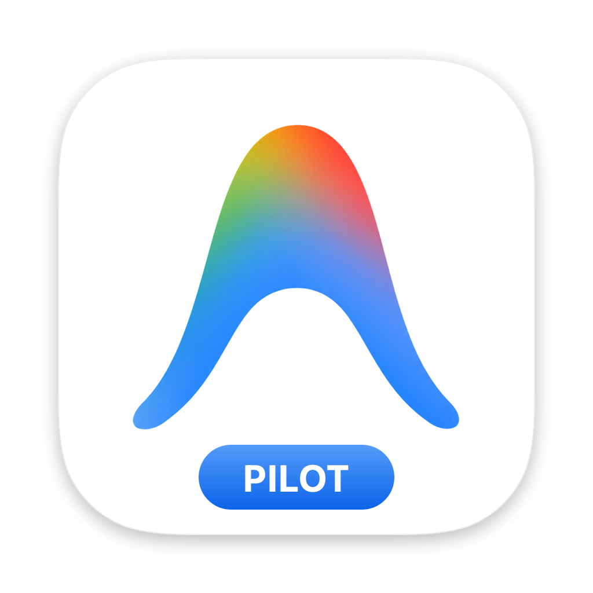
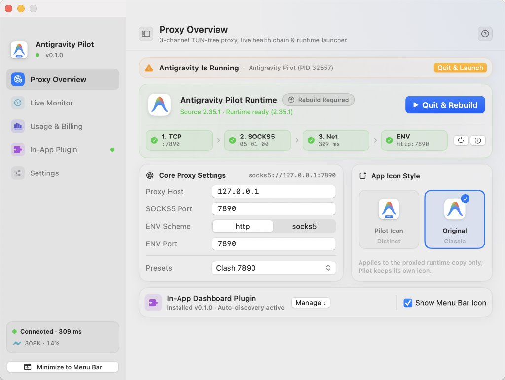
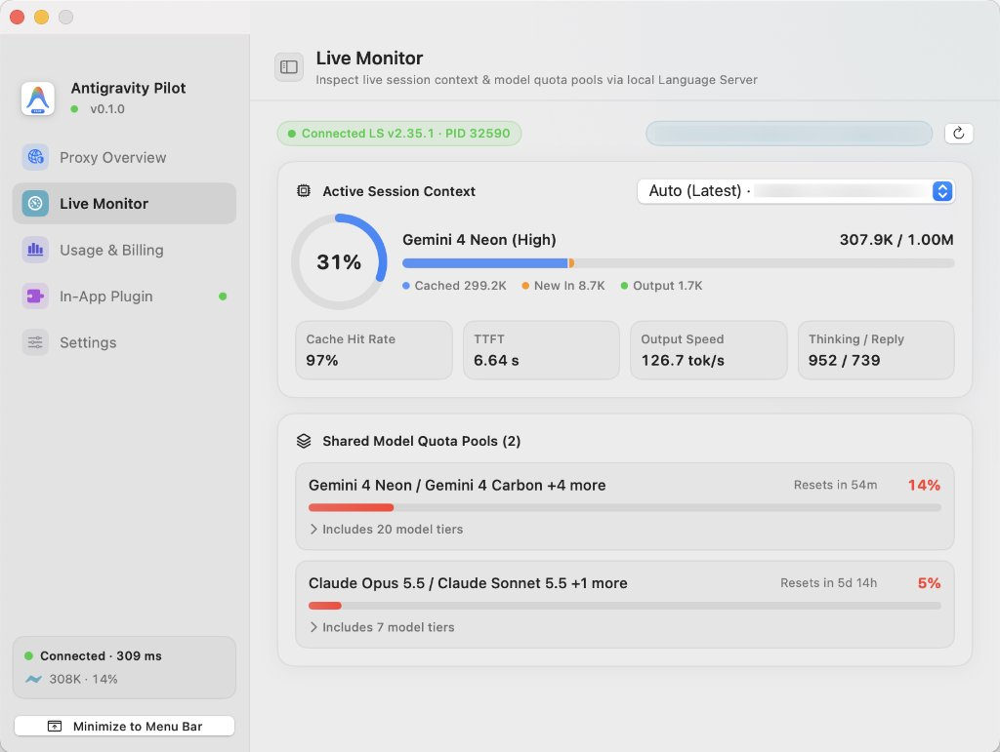
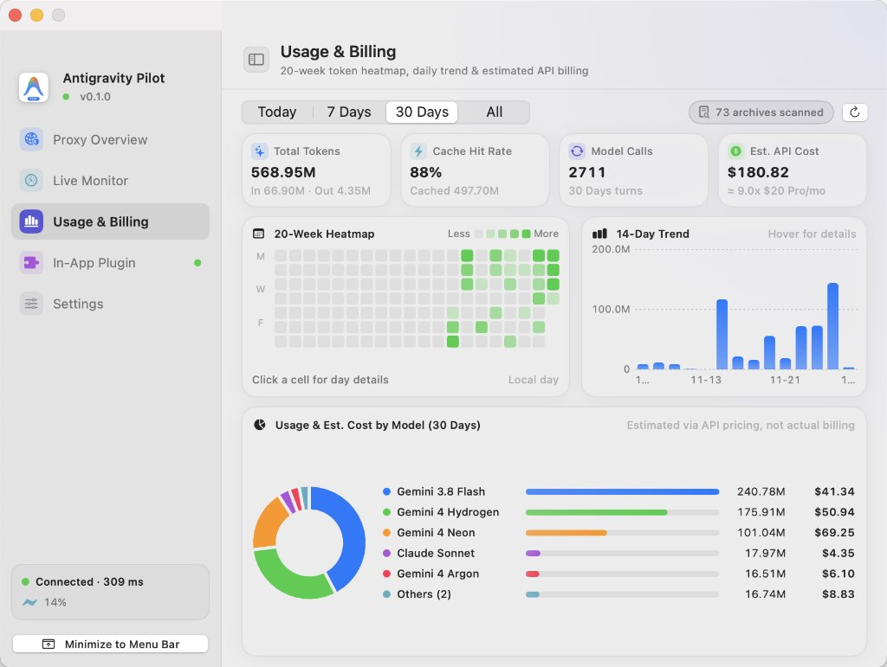
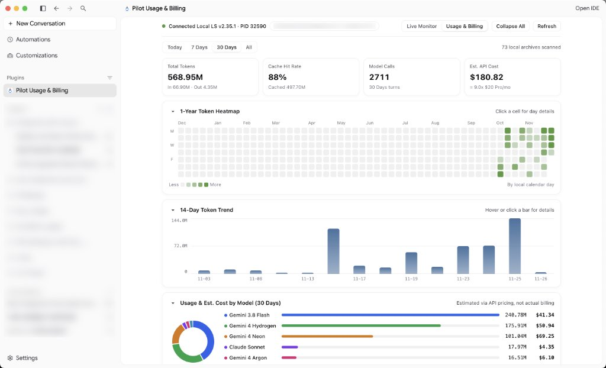

# Antigravity Pilot for macOS

<p align="center">
  
</p>

<p align="center">
  
  
  
  
</p>

<p align="center">
  <strong>简体中文</strong> | <a href="README.zh-Hant.md">繁體中文</a> | <a href="README.en.md">English</a> | <a href="README.ru.md">Русский</a>
</p>

专为 macOS 打造的 **Antigravity 零侵入原生伴侣**。无需开启 Clash TUN 模式，也不改动原版 `/Applications/Antigravity.app`，让 Antigravity 稳定走本机代理，并提供纯原生实时监控、配额池、用量账单与官方应用内看板。

---

## 界面预览

<table>
  <tr>
    <td align="center" width="33.3%">
      
      <br><sub>代理概览（三阶健康链路 & 热更新）</sub>
    </td>
    <td align="center" width="33.3%">
      
      <br><sub>实时监控（上下文占用 & 共享配额池）</sub>
    </td>
    <td align="center" width="33.3%">
      
      <br><sub>用量与账单（20 周热力图 & 费用估算）</sub>
    </td>
  </tr>
  <tr>
    <td align="center" colspan="3">
      
      <br><sub>Antigravity 应用内 MCP 看板（左侧边栏全屏视图 · 1 年活跃热力图与模型占比）</sub>
    </td>
  </tr>
</table>

---

## 零侵入设计

| 维度 | Antigravity Pilot for macOS |
| :--- | :--- |
| **原版应用** | `/Applications/Antigravity.app` **100% 只读不动**，官方签名与目录结构完全不受影响 |
| **网络代理** | **免 TUN 精准分流**：仅代理 Antigravity 及其子进程，局域网 CIDR 直连绕过 |
| **监控采集** | **零 JS 注入、零 CDP**：纯原生 SwiftUI 读取本地守护进程只读 RPC 与日志归档 |
| **应用内看板** | **官方 MCP Apps (SEP-1865)**：安装至用户插件目录，原版与代理版通用 |
| **卸载还原** | 所有数据均在 `~/Library/Application Support/Antigravity Pilot/` 与 `~/.gemini/config/plugins/antigravity-pilot/`，删除即彻底还原 |

---

## 主要功能

- **免 TUN 代理与 0.1 秒热更新**：通过隔离代理副本让 Antigravity 走本机 SOCKS5/HTTP 代理（内置 7 组常用预设、支持 IPv4/IPv6 与 `NO_PROXY` 局域网绕过），改端口免重建秒开。
- **三阶健康检测与冲突防护**：实时验证「TCP 端口 → SOCKS5 握手 → 外网 `generate_204`」链路与 ENV 端口，先校验代理再提示并一键优雅退出运行中实例。
- **纯原生实时监控**：查看当前对话上下文占用、缓存命中率、TTFT、生成速度与共享配额池倒计时（含 `0%` 已耗尽配额池），默认自动跟随最新会话并支持手动固定。
- **Token 用量热力图与费用估算**：展示 20 周活跃热力图、近 14 日趋势、模型占比与估算 API 账单（支持 `custom_pricing.json` 自定义计费）。
- **菜单栏伴侣与官方应用内插件**：主窗口可缩入菜单栏常驻并支持开机自启；一键在 Antigravity 边栏与对话 `+` 菜单嵌入「用量与账单 / 实时监控」看板（0 Token 刷新、自动亮暗主题）。
- **应用内自更新与多语言图标切换**：支持从 GitHub Releases 自动检查更新并校验 SHA-256 后原地升级；支持 Pilot / 原版图标切换与简/繁中文、English、Русский 四语界面。

---

## 目录

- [界面预览](#界面预览)
- [零侵入设计](#零侵入设计)
- [主要功能](#主要功能)
- [快速开始](#快速开始)
- [日常使用与维护](#日常使用与维护)
- [主要功能实现原理](#主要功能实现原理)
- [本地构建与测试](#本地构建与测试)
- [故障排查](#故障排查)
- [限制](#限制)
- [致谢与许可证](#致谢与许可证)
- [联系与合作](#联系与合作)

---

## 快速开始

### 系统要求

- **macOS 13.0 (Ventura) 及以上**（支持 Apple Silicon `arm64` 与 Intel `x86_64` Universal）
- **Xcode Command Line Tools**（生成/重建本地代理副本时用于重签名，未安装可执行 `xcode-select --install`）
- 本机已安装原版 **`/Applications/Antigravity.app`**（Release 包不含原版应用）

### Step 1: 下载并安装 Antigravity Pilot.app

前往 [Releases](https://github.com/TakeshiKaneshivo/antigravity-pilot-macos/releases) 下载 `Antigravity-Pilot-v0.1.0-macOS13-universal.dmg`（或参考[本地构建与测试](#本地构建与测试)自行编译），打开镜像后将 `Antigravity Pilot.app` 拖入 `Applications`。

> **提示**：应用采用本地 ad-hoc 签名，首次打开若提示“**已损坏，无法打开**”或“**无法验证开发者**”，执行以下命令清除隔离属性即可：
>
> ```bash
> xattr -cr "/Applications/Antigravity Pilot.app"
> ```

### Step 2: 选择代理预设并启动

打开 `/Applications/Antigravity Pilot.app`，左侧边栏提供五个原生页面：**代理概览**、**实时监控**、**用量与账单**、**应用内插件**、**高级设置**。

1. 在「核心代理配置」的 **常用预设** 下拉菜单中直接选择你使用的代理客户端（内置 `Clash 7890`、`Verge 7897`、`Clash 7891`、`Surge 6153`、`v2ray 10808`、`Sing-box 12334`、`SOCKS 1080` 7 组预设）；若使用其他端口，手动填写 Host、SOCKS5 端口及 ENV 协议/端口即可。
2. 确认三阶健康链全绿后，点击顶部卡片**右上角**的 **重建副本并启动**（已存在同版本副本时显示 **保存并极速启动**）。

### Step 3: Dock 单图标秒开与菜单栏常驻

1. 代理版 Antigravity 启动后，右键 Dock 上正在运行的图标 → **「选项 → 在程序坞中保留」**（可将原版图标移出 Dock 以免误点）。
2. 关闭 `Antigravity Pilot` 主窗口后自动缩入右上角菜单栏（Dock 仅保留正在运行的 Antigravity 一个图标），显示紧凑指标（如 `188K · 89%`），点击可展开快捷监控浮窗。
3. 配置文件保存在 `~/Library/Application Support/Antigravity Pilot/config.json`。

---

## 日常使用与维护

### 图标切换与自定义图标

- **切换内置样式**：在主窗口「应用图标样式」可随时在 **Pilot 标识** 与 **原版图标** 间切换（仅作用于代理副本，`/Applications/Antigravity Pilot.app` 伴侣始终保持 `PILOT` 图标以便区分）。
- **自定义 PNG 图标**：替换仓库根目录 `icon.png`（建议 `1024×1024` 透明底、居中 `824×824`、留白 `100 px`），再运行 `./build.sh` 即可。

### 更新 Pilot 与原版 Antigravity

- **更新 Antigravity Pilot 本体**：点击左侧边栏底部版本号可打开软件更新浮窗，支持自动检测 GitHub Releases、直连/代理双路由下载 DMG 并校验 SHA-256 后原地替换重启。
- **更新原版 `/Applications/Antigravity.app`**：原版更新后，从 Dock 启动代理副本会自动提示版本变化。先退出运行中的 Antigravity，再打开 `/Applications/Antigravity Pilot.app` 重建副本即可，Dock 固定位置不变。

### 停止后台进程

通常使用 `Cmd + Q` 或从菜单栏退出即可；若需清理残留子进程（含 Helper 进程），可在仓库目录运行：

```bash
./stop-antigravity-proxy.sh
```

### 卸载与清理

1. 若安装了应用内看板，可在 **应用内插件** 页签点击 **卸载**。
2. 退出 Antigravity 与菜单栏中的 Antigravity Pilot，取消固定 Dock 图标并删除 `/Applications/Antigravity Pilot.app`。
3. 清理用户空间隔离目录（原版 `/Applications/Antigravity.app` 全程未受任何修改）：

```bash
rm -rf "$HOME/Library/Application Support/Antigravity Pilot"
rm -rf "$HOME/Library/Application Support/Antigravity Proxy"
rm -rf "$HOME/.gemini/config/plugins/antigravity-pilot"
```

---

## 主要功能实现原理

1. **零侵入隔离副本**：原版 `/Applications/Antigravity.app` 开启了 Hardened Runtime 会屏蔽外部动态库注入，因此 Pilot 保持原版只读不动，仅在用户目录创建单层隔离 Runtime 副本并合并 Entitlements 后本地重签名。
2. **三通道免 TUN 代理**：由 `libantigravity_proxy.dylib`（`__DATA,__interpose` + `198.18.0.0/15` FakeIP 转 SOCKS5）、Go/Node 环境变量及主 Chromium `--proxy-server` 参数协同接管全部进程流量，并按 `NO_PROXY` 规则直连局域网 CIDR。
3. **0.1 秒热更新与单图标**：`AntigravityProxyLauncher` 优先读取外置 `proxy.env` 后原地 `execv()` 拉起主程序；改端口或 `NO_PROXY` 仅重写外置文件，无需重复制和重签名。
4. **原生实时监控**：自动发现本地 `~/.gemini/antigravity/daemon/hub_*.json`，通过禁用代理的回环 Connect-RPC 读取上下文占用、性能指标与模型共享配额池。
5. **增量用量与账单**：按 `size + mtime` 增量扫描 `transcript.jsonl` 并缓存至 `usage_cache.json`，结合内置/自定义定价表估算每日及分模型 API 费用。
6. **官方应用内看板与图标同步**：通过官方 MCP Apps（SEP-1865）提供零 JS 注入、0 Token 刷新的应用内看板；切换 Pilot 图标时同步按 Chromium Pickle 4 字节对齐更新 `app.asar` 与 `ElectronAsarIntegrity`。

---

## 本地构建与测试

### 编译与打包

需要 Xcode Command Line Tools（`xcode-select --install`）：

```bash
# 编译 macOS 13.0+ Universal (arm64 + x86_64) 应用与原生二进制
./build.sh

# 运行 Web 类型检查、重编前端看板并打包 .dmg 与 latest.json（输出 SHA256）
npm --prefix src/McpAppWeb run typecheck && ./build.sh --build-web --dmg
```

常用参数与环境变量：`--notes-file <path>` 可传入发布说明；支持 `APP_VERSION`（默认 `0.1.0`）、`MIN_MACOS`（默认 `13.0`）、`ARCHS`（默认 `"arm64 x86_64"`）、`GITHUB_REPO` 覆盖。

主要产物：`build/Antigravity Pilot.app`、`build/Antigravity-Pilot-v0.1.0-macOS13-universal.dmg`、`build/latest.json`、`build/antigravity-pilot-mcp`、`build/libantigravity_proxy.dylib`、`build/AntigravityProxyLauncher`、`build/test_client`。

### 自动化校验与本地抓包测试

```bash
# 非 UI 原生冒烟测试 & MCP Server 端到端协议测试
"build/Antigravity Pilot.app/Contents/MacOS/AntigravityProxyBuilder" --smoke-test
python3 tests/test_mcp_server.py

# 验证 FakeIP 分配与 SOCKS5 ATYP=0x03 域名转发（在两个终端依次执行）
./tests/socks5_capture.py 18081
AG_PROXY=socks5://127.0.0.1:18081 AG_PROXY_LOG=1 \
  DYLD_INSERT_LIBRARIES="$PWD/build/libantigravity_proxy.dylib" \
  ./build/test_client login.example.test 443
```

成功时捕获服务会输出 `captured login.example.test:443`。

---

## 故障排查

- **提示“已损坏，无法打开”或“无法验证开发者”**：在终端执行 `xattr -cr "/Applications/Antigravity Pilot.app"`。
- **点击重建提示缺少 Xcode 命令行工具**：执行 `xcode-select --install`。
- **诊断链提示「非 SOCKS5 端口」或「外网未通」**：前者说明填入的是纯 HTTP 端口，请改用 Clash Mixed Port（如 `7890` / `7897`）或独立 SOCKS5 端口；后者表示端口可达但代理节点未能访问 `www.google.com/generate_204`，请检查代理节点与规则。
- **切换图标后 Dock 图标未立即变化**：完全退出 Antigravity 后执行 `killall Dock`。
- **启动后显示空白 Electron 页面（`To run a local app...`）**：退出后在「高级设置」点击 **强制完整重建副本** 重新同步 `ElectronAsarIntegrity`。
- **原版与代理版不能同时打开**：两者共用同一个用户数据目录与单实例锁，请在顶部冲突栏点击 **优雅退出并启动** 自动切换。

---

## 限制

- dylib hook 仅拦截 TCP `connect()`，不处理 UDP/QUIC，且目前仅支持无认证 SOCKS5 代理。
- 代理地址建议使用数字 IP（如 `127.0.0.1` 或 `[::1]`）或 `localhost`。
- 历史费用账单基于内置公开 API 参考定价表估算（可在 `~/Library/Application Support/Antigravity Pilot/custom_pricing.json` 覆写），不代表实际订阅扣费。
- `Antigravity Pilot.app` 目前使用本地 ad-hoc 签名；公开分发时建议进一步使用 Developer ID 签名并公证。

---

## 致谢与许可证

- [OkamiFeng/mac-antigravity-proxy-dylib](https://github.com/OkamiFeng/mac-antigravity-proxy-dylib)：本项目最初基于该项目的早期版本演进与重构而来，感谢原作者在 macOS dylib 代理注入与签名流程上的开创性工作。
- [yuaotian/antigravity-proxy](https://github.com/yuaotian/antigravity-proxy)：感谢 Windows 版本的 DLL 注入代理拦截思路启发（本项目在 macOS 上采用 `DYLD_INSERT_LIBRARIES` 注入 dylib 实现）。

MIT License。详见 [LICENSE](LICENSE)。

---

## 联系与合作

商务合作请联系：[takeshikaneshivo@gmail.com](mailto:takeshikaneshivo@gmail.com)
