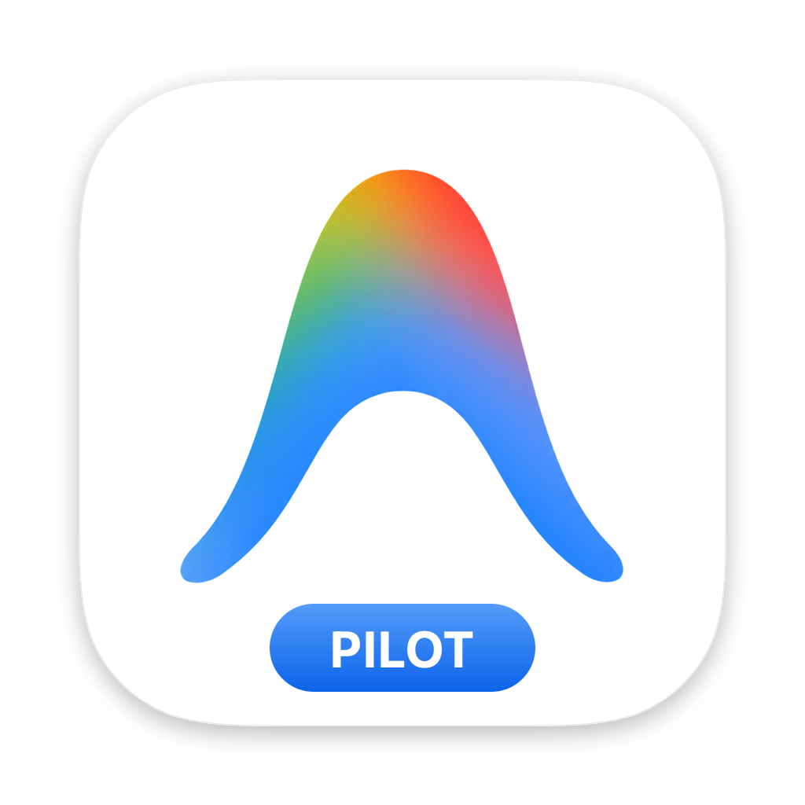
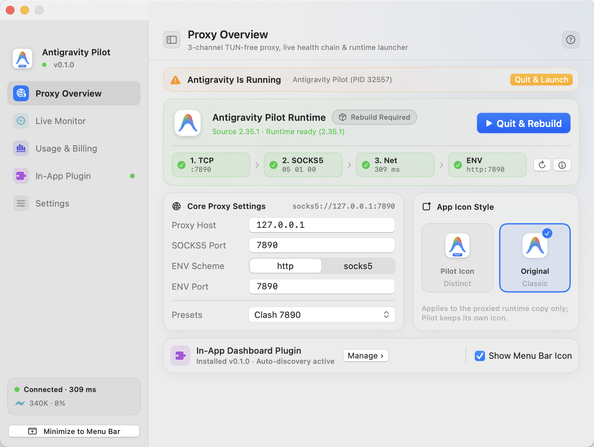
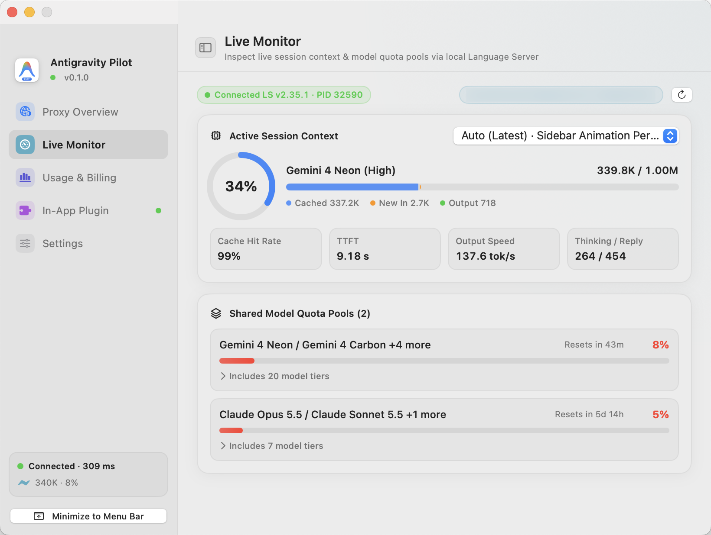
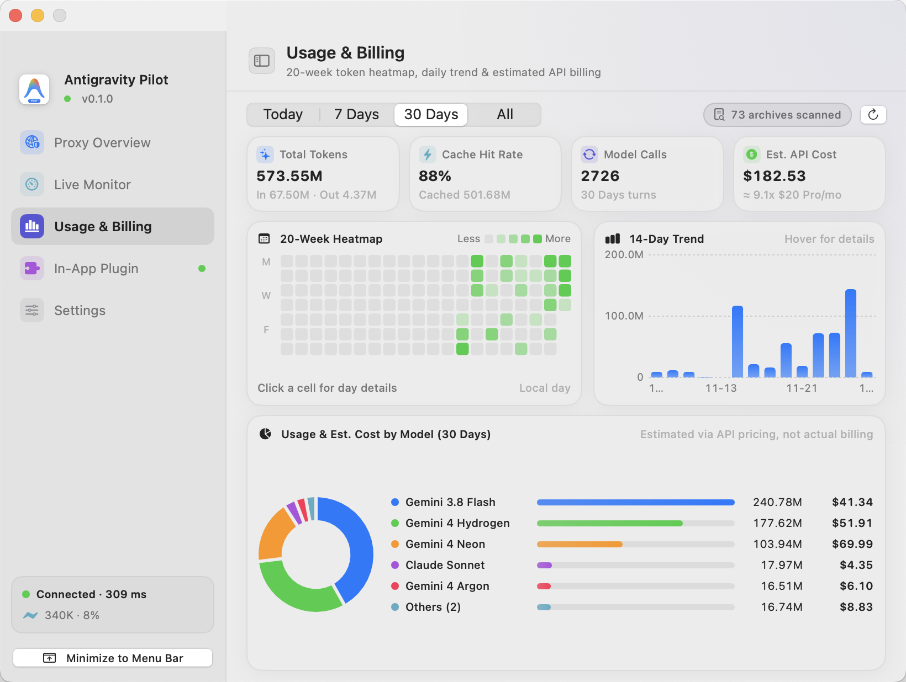
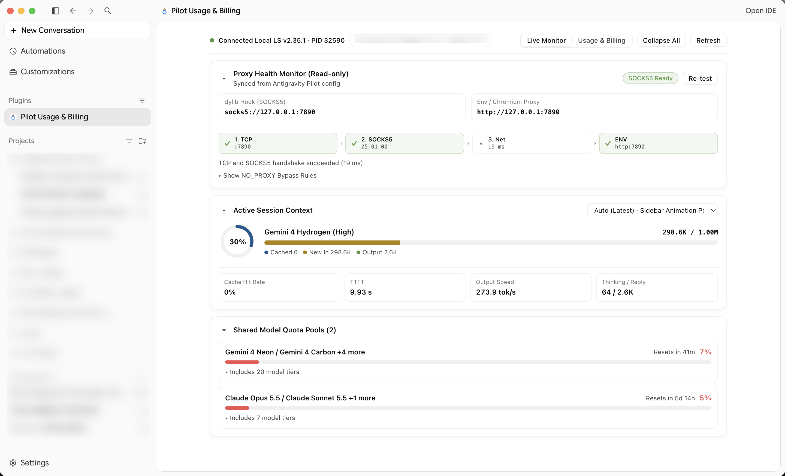
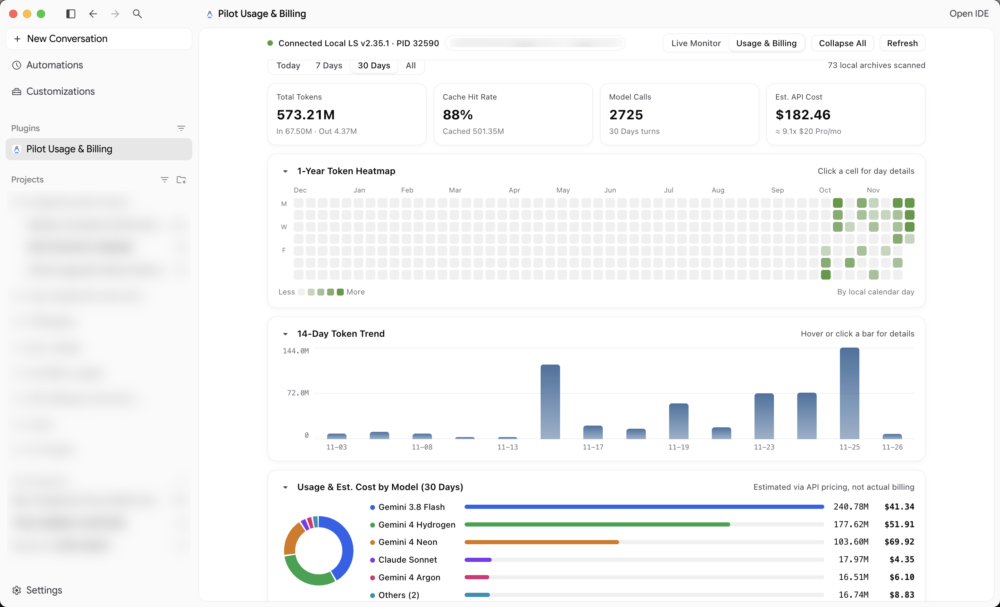

# Antigravity Pilot for macOS

<p align="center">
  
</p>

<p align="center">
  
  
  
  
</p>

<p align="center">
  <a href="README.md">简体中文</a> | <a href="README.zh-Hant.md">繁體中文</a> | <a href="README.en.md">English</a> | <strong>Русский</strong>
</p>

Нативный компаньон для Antigravity на macOS с **нулевым вмешательством**. Направляет трафик Antigravity через локальный прокси без режима Clash TUN и не изменяет `/Applications/Antigravity.app`, предоставляя нативный живой монитор, пулы квот, учёт токенов и официальную встроенную панель.

---

## Скриншоты

<table>
  <tr>
    <td align="center" width="33.3%">
      
      <br><sub>Прокси (3-этапная проверка и хот-апдейт)</sub>
    </td>
    <td align="center" width="33.3%">
      
      <br><sub>Монитор (Контекст и пулы квот)</sub>
    </td>
    <td align="center" width="33.3%">
      
      <br><sub>Расход и счёт (Карта за 20 недель и оценка)</sub>
    </td>
  </tr>
</table>

<table>
  <tr>
    <td align="center" width="50%">
      
      <br><sub>Встроенная панель MCP · Монитор (Прокси, контекст и квоты)</sub>
    </td>
    <td align="center" width="50%">
      
      <br><sub>Встроенная панель MCP · Расход и счёт (Карта за 1 год и модели)</sub>
    </td>
  </tr>
</table>

---

## Нулевое вмешательство

| Аспект | Antigravity Pilot for macOS |
| :--- | :--- |
| **Оригинальное приложение** | `/Applications/Antigravity.app` **по умолчанию только для чтения и без инъекций**; заменяется атомарно на официальный пакет Google (SHA-512 + подпись) только по вашему нажатию **Обновить и пересобрать** |
| **Маршрутизация прокси** | **Точечный прокси без TUN**: проксируется только Antigravity; локальные CIDR идут напрямую |
| **Телеметрия** | **Без JS-инъекций и без CDP**: нативный SwiftUI читает локальный RPC и архивы логов |
| **Встроенная панель** | **Официальный MCP Apps (SEP-1865)**: плагин в папке пользователя, работает везде |
| **Удаление** | Все файлы изолированы в `~/Library/Application Support/Antigravity Pilot/` и `~/.gemini/config/plugins/antigravity-pilot/` |

---

## Основные возможности

- **Прокси без TUN и хот-апдейт за 0.1 с**: направляет Antigravity через локальный SOCKS5/HTTP-прокси в изолированной копии (7 пресетов, IPv4/IPv6, обход `NO_PROXY`), смена портов без пересборки.
- **3-этапная диагностика и защита от конфликтов**: проверка TCP-порта, SOCKS5-рукопожатия и выхода в сеть (`generate_204`); сначала проверяет прокси, затем аккуратно завершает запущенные копии.
- **Нативный живой монитор**: состав контекста и иерархия шагов, TTFT, скорость и двух-оконные пулы квот `5h` / `7d` с автовыбором или закреплением чата.
- **Тепловая карта и оценка стоимости**: 20-недельная карта, тренд за 14 дней, атрибуция Desktop + CLI, автосинхронизация тарифов и 4 палитры Моранди (синхронизация с панелью MCP).
- **Строка меню и плагин MCP**: сворачивание в меню (счётчик в дуге, контекст и квота `5h`/`7d`), нативные уведомления об обновлении оригинала и встроенная панель (0 токенов).
- **Автообновление и 4 языка**: проверка SHA-256 через прокси или напрямую, 3 стиля иконки копии (Со значком / Оригинал / Pilot) и 4 языка интерфейса.

---

## Содержание

- [Скриншоты](#скриншоты)
- [Нулевое вмешательство](#нулевое-вмешательство)
- [Основные возможности](#основные-возможности)
- [Быстрый старт](#быстрый-старт)
- [Повседневное использование и обслуживание](#повседневное-использование-и-обслуживание)
- [Принцип работы](#принцип-работы)
- [Сборка и тестирование](#сборка-и-тестирование)
- [Устранение неполадок](#устранение-неполадок)
- [Ограничения](#ограничения)
- [Благодарности и лицензия](#благодарности-и-лицензия)
- [Контакты](#контакты)

---

## Быстрый старт

### Системные требования

- **macOS 13.0 (Ventura) и выше** (Universal: Apple Silicon `arm64` и Intel `x86_64`)
- **Xcode Command Line Tools** (для локальной подписи `codesign` при сборке копии; при необходимости выполните `xcode-select --install`)
- Установленный оригинальный **`/Applications/Antigravity.app`** (в релизах он не содержится)

### Шаг 1: Скачайте и установите Antigravity Pilot.app

**Вариант A: Установка одной командой (рекомендуется — проверяет SHA-256 и избавляет от блокировки Gatekeeper)**

```bash
curl -fsSL https://raw.githubusercontent.com/TakeshiKaneshivo/antigravity-pilot-macos/main/install.sh | bash
```

**Вариант B: Ручная загрузка DMG**

Скачайте `Antigravity-Pilot-v0.2.0-macOS13-universal.dmg` на странице [Releases](https://github.com/TakeshiKaneshivo/antigravity-pilot-macos/releases) (или соберите по разделу [Сборка и тестирование](#сборка-и-тестирование)) и перетащите `Antigravity Pilot.app` в `Applications`.

> **Примечание**: приложение имеет локальную ad-hoc подпись. Если после загрузки через браузер macOS сообщает о повреждении файла или неизвестном разработчике, используйте Вариант A или снимите карантин:
>
> ```bash
> xattr -cr "/Applications/Antigravity Pilot.app"
> ```

### Шаг 2: Выберите пресет прокси и запустите

Откройте `/Applications/Antigravity Pilot.app` — слева доступны пять вкладок: **Прокси**, **Монитор**, **Расход и счёт**, **Плагин в IDE**, **Настройки**.

1. В разделе **Настройки прокси → Пресеты** выберите ваш клиент (`Clash 7890`, `Verge 7897`, `Clash 7891`, `Surge 6153`, `v2ray 10808`, `Sing-box 12334`, `SOCKS 1080`) или задайте хост, порт SOCKS5 и протокол/порт ENV вручную.
2. Дождитесь зелёного статуса 3-этапной проверки и нажмите **Собрать и запуск** (или **Сохранить и запуск** при наличии готовой копии) в **правом верхнем углу** карточки.

### Шаг 3: Закрепление в Dock и работа из строки меню

1. После запуска прокси-копии нажмите ПКМ по её иконке в Dock → **Параметры → Оставить в Dock** (оригинал можно убрать из Dock во избежание случайного запуска).
2. Закрытие окна `Antigravity Pilot` сворачивает его в строку меню (одна иконка Antigravity в Dock), показывая метрики вроде `② 148K · 5h 39%` (настраивается в **Настройках**) и быструю сводку.
3. Настройки сохраняются в `~/Library/Application Support/Antigravity Pilot/config.json`.

---

## Повседневное использование и обслуживание

### Переключение и замена иконки

- **Встроенные стили**: в карточке **Иконка приложения** можно переключаться между **Со значком (Рек.)**, **Оригинал** и **Pilot** (меняется только копия; сам `/Applications/Antigravity Pilot.app` сохраняет значок `PILOT`).
- **Своя PNG-иконка**: замените `icon.png` (рекомендуется `1024×1024` с прозрачным фоном, объект `824×824` по центру) или `menubar-icon.png` (монохромный значок меню) в корне репозитория и запустите `./build.sh`.

### Обновление Pilot и оригинального Antigravity

- **Обновление Antigravity Pilot**: нажмите на версию внизу боковой панели, чтобы проверить GitHub Releases, скачать DMG (напрямую или через прокси), сверить SHA-256 и обновиться на месте.
- **Обновление оригинального `/Applications/Antigravity.app`**: в копии отключён нерабочий Squirrel; Pilot проверяет официальный фид через прокси. Кнопка **Обновить и пересобрать** сверяет SHA-512 и подпись Google и атомарно обновляет копию и оригинал, а при любых обновлениях оригинала приходят уведомления macOS.

### Остановка фоновых процессов

Обычно достаточно `Cmd + Q` или выхода из строки меню. Для принудительной остановки всех процессов (включая Helper):

```bash
./stop-antigravity-proxy.sh
```

### Удаление

1. Если установлен встроенный плагин, нажмите **Удалить** во вкладке **Плагин в IDE**.
2. Закройте Antigravity и значок Pilot в строке меню, открепите иконку из Dock и удалите `/Applications/Antigravity Pilot.app`.
3. Удалите изолированные каталоги (оригинальный `/Applications/Antigravity.app` остаётся нетронутым):

```bash
rm -rf "$HOME/Library/Application Support/Antigravity Pilot"
rm -rf "$HOME/Library/Application Support/Antigravity Proxy"
rm -rf "$HOME/.gemini/config/plugins/antigravity-pilot"
```

---

## Принцип работы

1. **Изолированная копия без вмешательства**: `/Applications/Antigravity.app` защищён Hardened Runtime и блокирует инъекцию библиотек, поэтому Pilot не трогает оригинал, а создаёт изолированную копию в папке пользователя и подписывает её с нужными Entitlements.
2. **Трёхканальный прокси без TUN**: `libantigravity_proxy.dylib` (`__DATA,__interpose` + FakeIP `198.18.0.0/15` через SOCKS5), переменные окружения Go/Node и флаги главного процесса Chromium совместно маршрутизируют трафик, пропуская локальные CIDR по `NO_PROXY`.
3. **Хот-апдейт за 0.1 с и одна иконка в Dock**: `AntigravityProxyLauncher` читает `proxy.env` и заменяет себя через `execv()`, поэтому смена портов не требует переподписи, а хэши SHA-256 бинарников защищают от ложной пересборки после `codesign`.
4. **Нативный мониторинг**: находит `~/.gemini/antigravity/daemon/hub_*.json` и запрашивает локальный Connect-RPC без прокси для отображения контекста, скорости и квот моделей.
5. **Инкрементальный учёт и стоимость**: инкрементально сканирует логи Desktop + CLI по `size + mtime` в `usage_cache.json` и оценивает расходы по автосинхронизируемому `pricing-catalog.json` (или `custom_pricing.json`).
6. **Официальный MCP Apps и целостность ASAR**: панель работает без JS-инъекций и с 0 токенов на обновление (SEP-1865), а при смене иконки Pilot синхронизирует `app.asar` и `ElectronAsarIntegrity` с выравниванием Chromium Pickle.

---

## Сборка и тестирование

### Сборка и упаковка

Требуются Xcode Command Line Tools (`xcode-select --install`):

```bash
# Сборка Universal (arm64 + x86_64) для macOS 13.0+ (с инкрементальным кэшем build/.cache)
./build.sh

# Быстрая локальная инкрементальная сборка только под архитектуру текущего Mac
./build.sh --native

# Проверка типов TypeScript, пересборка веб-панели и упаковка .dmg + latest.json (с SHA256)
npm --prefix src/McpAppWeb run typecheck && ./build.sh --build-web --dmg
```

- **Флаги сборки**: `--native` (под текущий Mac), `--clean` (очистка `build/.cache`), `--notes-file <path>` (примечания к релизу).
- **Переменные**: `APP_VERSION` (`0.2.0`), `MIN_MACOS` (`13.0`), `ARCHS` (`"arm64 x86_64"`) и `GITHUB_REPO`.

Выходные файлы: `build/Antigravity Pilot.app`, `build/Antigravity-Pilot-v0.2.0-macOS13-universal.dmg`, `build/latest.json`, `build/antigravity-pilot-mcp`, `build/libantigravity_proxy.dylib`, `build/AntigravityProxyLauncher`, `build/test_client`.

### Автотесты и локальная проверка SOCKS5

```bash
# Дымовые тесты и E2E-тесты MCP-сервера
"build/Antigravity Pilot.app/Contents/MacOS/AntigravityProxyBuilder" --smoke-test
python3 tests/test_mcp_server.py

# Проверка FakeIP и проксирования через SOCKS5 ATYP=0x03 (в двух терминалах)
./tests/socks5_capture.py 18081
AG_PROXY=socks5://127.0.0.1:18081 AG_PROXY_LOG=1 \
  DYLD_INSERT_LIBRARIES="$PWD/build/libantigravity_proxy.dylib" \
  ./build/test_client login.example.test 443
```

При успехе сервер выведет `captured login.example.test:443`.

---

## Устранение неполадок

- **macOS сообщает «Файл повреждён» или «Не удаётся проверить разработчика»**: выполните `xattr -cr "/Applications/Antigravity Pilot.app"`.
- **Запрос на установку Xcode Command Line Tools**: выполните `xcode-select --install`.
- **«Не SOCKS5 порт» или «Нет сети»**: первый статус означает HTTP-порт вместо SOCKS5 (используйте mixed port Clash `7890`/`7897` или отдельный порт SOCKS5); второй — сбой `www.google.com/generate_204` через прокси-узел.
- **Иконка в Dock не обновилась после переключения**: закройте Antigravity и выполните `killall Dock`.
- **Пустое окно Electron (`To run a local app...`)**: закройте IDE и нажмите **Полная пересборка** во вкладке **Настройки** для повторной синхронизации `ElectronAsarIntegrity`.
- **Оригинал и Pilot не запускаются одновременно**: они делят общий профиль Electron и блокировку экземпляра; используйте **Закрыть и запуск** на баннере конфликта.

---

## Ограничения

- Dylib-перехват обрабатывает только TCP `connect()` (без UDP/QUIC) и поддерживает SOCKS5 без авторизации.
- В качестве хоста прокси рекомендуется использовать числовой IP (`127.0.0.1` или `[::1]`) или `localhost`.
- Суммы расходов оцениваются по публичным тарифам API (настраиваются в `~/Library/Application Support/Antigravity Pilot/custom_pricing.json`) и не отражают списания по подписке.
- `Antigravity Pilot.app` подписан локально (ad-hoc); для массового распространения рекомендуется Developer ID и нотаризация.

---

## Благодарности и лицензия

- [OkamiFeng/mac-antigravity-proxy-dylib](https://github.com/OkamiFeng/mac-antigravity-proxy-dylib): проект изначально вырос из ранней версии этого репозитория — спасибо автору за базовую реализацию dylib-инъекции и переподписи на macOS.
- [yuaotian/antigravity-proxy](https://github.com/yuaotian/antigravity-proxy): за идею перехвата сетевых вызовов (DLL-инъекция в Windows и `DYLD_INSERT_LIBRARIES` в macOS).

MIT License. Подробности в [LICENSE](LICENSE).

---

## Контакты

По вопросам сотрудничества и коммерческих предложений: [takeshikaneshivo@gmail.com](mailto:takeshikaneshivo@gmail.com)
