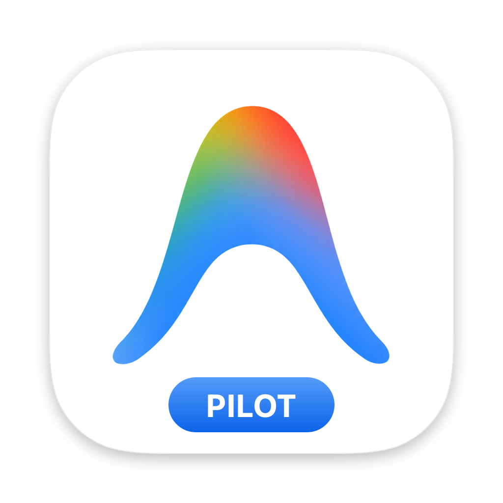
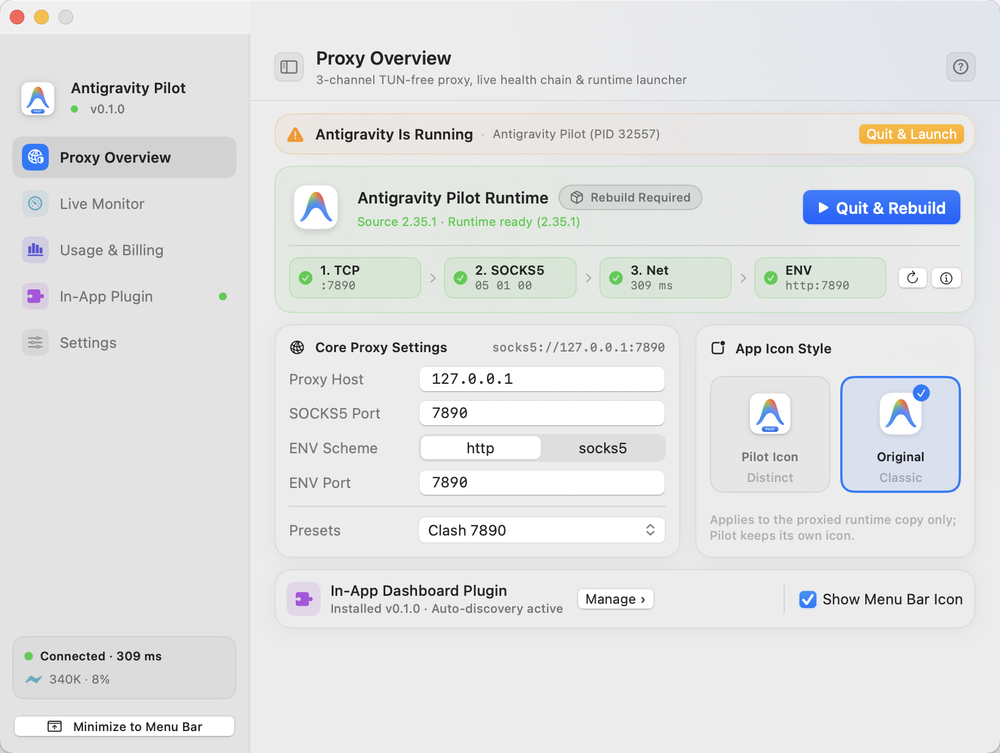
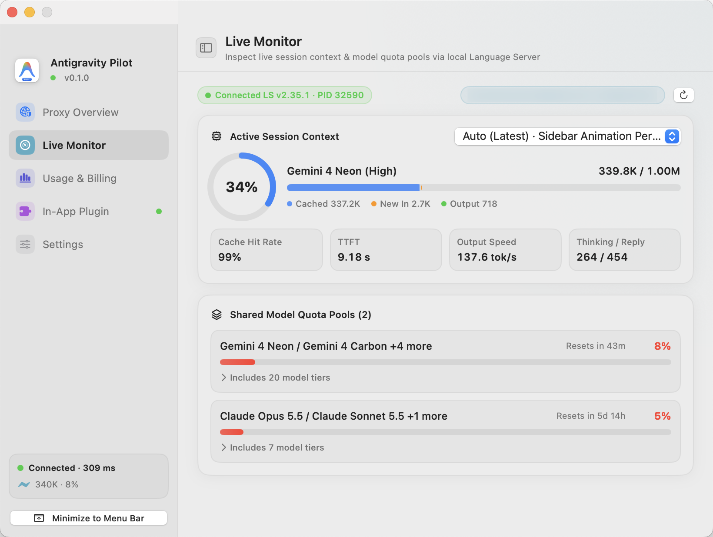
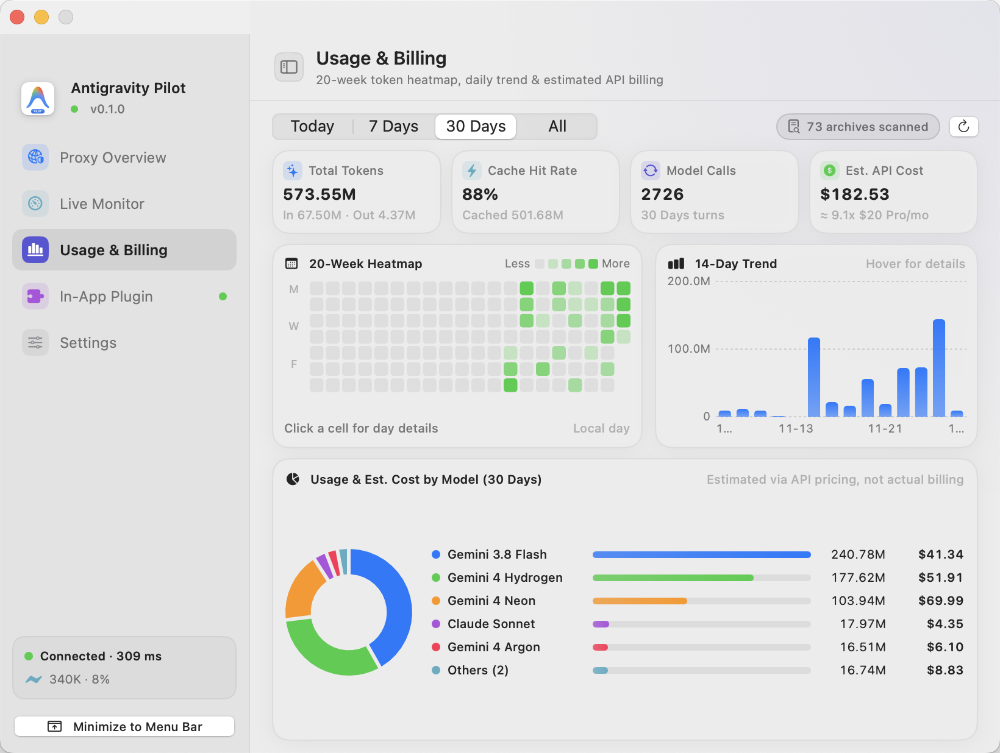
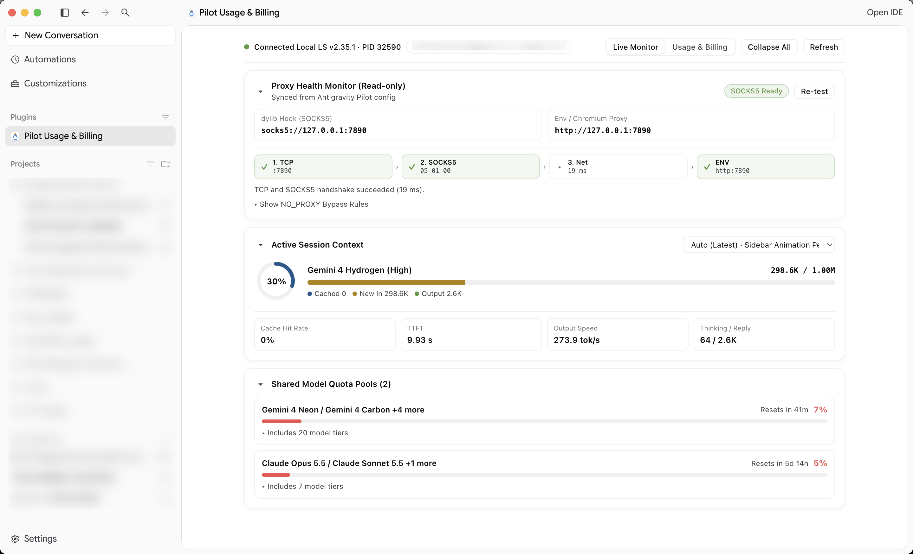
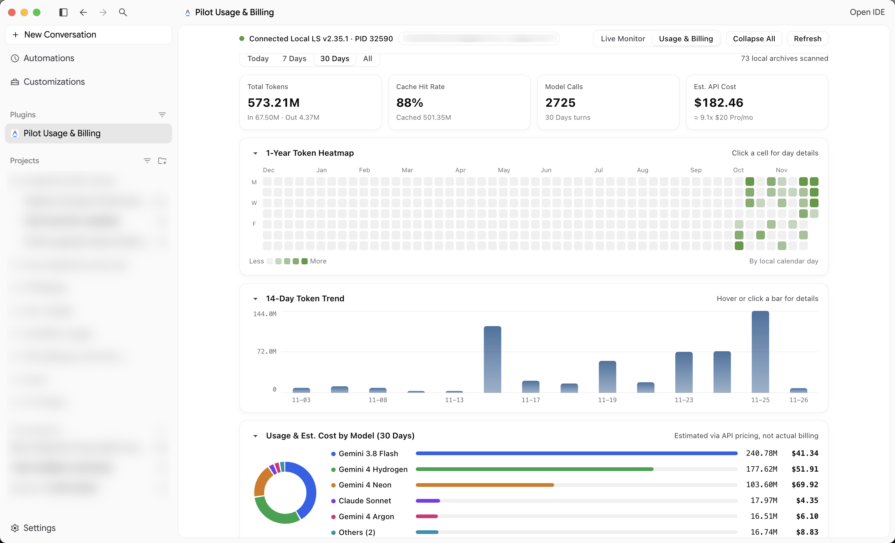

# Antigravity Pilot for macOS

<p align="center">
  
</p>

<p align="center">
  
  
  
  
</p>

<p align="center">
  <a href="README.md">简体中文</a> | <strong>繁體中文</strong> | <a href="README.en.md">English</a> | <a href="README.ru.md">Русский</a>
</p>

專為 macOS 打造的 **Antigravity 零侵入原生伴侶**。無需開啟 Clash TUN 模式，也不改動原版 `/Applications/Antigravity.app`，讓 Antigravity 穩定經由本機代理連線，並提供純原生即時監控、配額池、用量帳單與官方應用內看板。

---

## 介面預覽

<table>
  <tr>
    <td align="center" width="33.3%">
      
      <br><sub>代理概覽（三階健康鏈路 & 熱更新）</sub>
    </td>
    <td align="center" width="33.3%">
      
      <br><sub>即時監控（上下文佔用 & 共享配額池）</sub>
    </td>
    <td align="center" width="33.3%">
      
      <br><sub>用量與帳單（20 週熱力圖 & 費用估算）</sub>
    </td>
  </tr>
</table>

<table>
  <tr>
    <td align="center" width="50%">
      
      <br><sub>應用內 MCP 看板 · 即時監控（代理診斷 & 上下文 / 配額池）</sub>
    </td>
    <td align="center" width="50%">
      
      <br><sub>應用內 MCP 看板 · 用量與帳單（1 年熱力圖 & 模型佔比）</sub>
    </td>
  </tr>
</table>

---

## 零侵入設計

| 維度 | Antigravity Pilot for macOS |
| :--- | :--- |
| **原版應用** | `/Applications/Antigravity.app` **預設唯讀不注入**；僅當你主動點擊「一鍵更新原版並重建」且新套件通過 SHA-512 與 Google 官方簽章校驗後才原子替換官方原套件 |
| **網路代理** | **免 TUN 精準分流**：僅代理 Antigravity 及其子程序，區域網路 CIDR 直連繞過 |
| **監控擷取** | **零 JS 注入、零 CDP**：純原生 SwiftUI 讀取本機常駐服務唯讀 RPC 與日誌歸檔 |
| **應用內看板** | **官方 MCP Apps (SEP-1865)**：安裝至使用者外掛目錄，原版與代理版通用 |
| **解除安裝還原** | 所有資料均在 `~/Library/Application Support/Antigravity Pilot/` 與 `~/.gemini/config/plugins/antigravity-pilot/`，刪除即徹底還原 |

---

## 主要功能

- **免 TUN 代理與 0.1 秒熱更新**：透過隔離代理副本讓 Antigravity 經由本機 SOCKS5/HTTP 代理連線（內建 7 組常用預設、支援 IPv4/IPv6 與 `NO_PROXY` 區網繞過），改連接埠免重建秒開。
- **三階健康偵測與衝突防護**：即時驗證「TCP 連接埠 → SOCKS5 交握 → 外網 `generate_204`」鏈路與 ENV 連接埠，先校驗代理再提示並一鍵優雅結束執行中執行個體。
- **純原生即時監控**：檢視目前對話上下文佔用、快取命中率、首字延遲 (TTFT)、輸出速度與共享配額池倒數（含 `0%` 已耗盡配額池），預設自動跟隨最新工作階段並支援手動固定。
- **Token 用量熱力圖與費用估算**：顯示 20 週活躍熱力圖、近 14 日趨勢、模型佔比與估算 API 帳單（支援 `custom_pricing.json` 自訂計費）。
- **選單列伴侶與官方應用內外掛**：主視窗可縮入選單列常駐並支援開機自啟；一鍵在 Antigravity 邊欄與對話 `+` 選單嵌入「用量與帳單 / 即時監控」看板（0 Token 重新整理、自動亮暗主題）。
- **應用內自更新與多語言圖示切換**：支援從 GitHub Releases 自動檢查更新並校驗 SHA-256 後原地升級；支援 Pilot / 原版圖示切換與簡/繁體中文、English、Русский 四語介面。

---

## 目錄

- [介面預覽](#介面預覽)
- [零侵入設計](#零侵入設計)
- [主要功能](#主要功能)
- [快速開始](#快速開始)
- [日常使用與維護](#日常使用與維護)
- [主要功能實現原理](#主要功能實現原理)
- [本機建置與測試](#本機建置與測試)
- [疑難排解](#疑難排解)
- [限制](#限制)
- [致謝與授權條款](#致謝與授權條款)
- [聯絡與合作](#聯絡與合作)

---

## 快速開始

### 系統需求

- **macOS 13.0 (Ventura) 及以上**（支援 Apple Silicon `arm64` 與 Intel `x86_64` Universal）
- **Xcode Command Line Tools**（產生/重建本機代理副本時用於重簽署，未安裝可執行 `xcode-select --install`）
- 本機已安裝原版 **`/Applications/Antigravity.app`**（Release 套件不含原版應用）

### Step 1: 下載並安裝 Antigravity Pilot.app

前往 [Releases](https://github.com/TakeshiKaneshivo/antigravity-pilot-macos/releases) 下載 `Antigravity-Pilot-v0.1.0-macOS13-universal.dmg`（或參考[本機建置與測試](#本機建置與測試)自行編譯），開啟映像檔後將 `Antigravity Pilot.app` 拖入 `Applications`。

> **提示**：應用採用本機 ad-hoc 簽章，首次開啟若出現「**已損毀，無法打開**」或「**無法驗證開發者**」，執行以下指令清除隔離屬性即可：
>
> ```bash
> xattr -cr "/Applications/Antigravity Pilot.app"
> ```

### Step 2: 選擇代理預設並啟動

開啟 `/Applications/Antigravity Pilot.app`，左側邊欄提供五個原生頁面：**代理概覽**、**即時監控**、**用量與帳單**、**應用內外掛**、**進階設定**。

1. 在「核心代理設定」的 **常用預設** 下拉選單中直接選擇你使用的代理軟體（內建 `Clash 7890`、`Verge 7897`、`Clash 7891`、`Surge 6153`、`v2ray 10808`、`Sing-box 12334`、`SOCKS 1080` 7 組預設）；若使用其他連接埠，手動填寫 Host、SOCKS5 連接埠及 ENV 協定/連接埠即可。
2. 確認三階健康鏈全綠後，點擊頂部卡片**右上角**的 **重建副本並啟動**（已存在同版本副本時顯示 **儲存並極速啟動**）。

### Step 3: Dock 單圖示秒開與選單列常駐

1. 代理版 Antigravity 啟動後，右鍵 Dock 上正在執行的圖示 → **「選項 → 在 Dock 中保留」**（可將原版圖示移出 Dock 以免誤點）。
2. 關閉 `Antigravity Pilot` 主視窗後自動縮入右上角選單列（Dock 僅保留正在執行的 Antigravity 單一圖示），顯示精簡指標（如 `188K · 89%`），點擊可展開快速監控浮窗。
3. 設定檔儲存於 `~/Library/Application Support/Antigravity Pilot/config.json`。

---

## 日常使用與維護

### 圖示切換與自訂圖示

- **切換內建樣式**：在主視窗「應用圖示樣式」可隨時在 **Pilot 識別** 與 **原版圖示** 間切換（僅作用於代理副本，`/Applications/Antigravity Pilot.app` 伴侶始終保持 `PILOT` 圖示以便區分）。
- **自訂 PNG 圖示**：替換倉庫根目錄 `icon.png`（建議 `1024×1024` 透明底、置中 `824×824`、留白 `100 px`），再執行 `./build.sh` 即可。

### 更新 Pilot 與原版 Antigravity

- **更新 Antigravity Pilot 本體**：點擊左側邊欄底部版本號可開啟軟體更新浮窗，支援自動偵測 GitHub Releases、直連/代理雙路由下載 DMG 並校驗 SHA-256 後原地替換重新啟動。
- **更新原版 `/Applications/Antigravity.app`**：隔離代理副本已停用會因 Bundle ID 與簽章差異反覆失敗的內建 Squirrel 更新器；改為由 `Antigravity Pilot` 經本機代理偵測官方更新源，點擊 **一鍵更新原版並重建** 即可自動完成 SHA-512 與 Google 官方簽章校驗、優雅結束、原子替換原版並重建重新啟動副本（若手動更新了原版，Pilot 也會自動提示重建）。

### 停止背景程序

通常使用 `Cmd + Q` 或從選單列結束即可；若需清理殘留子程序（含 Helper 程序），可在倉庫目錄執行：

```bash
./stop-antigravity-proxy.sh
```

### 解除安裝與清理

1. 若安裝了應用內看板，可在 **應用內外掛** 分頁點擊 **解除安裝**。
2. 結束 Antigravity 與選單列中的 Antigravity Pilot，取消固定 Dock 圖示並刪除 `/Applications/Antigravity Pilot.app`。
3. 清理使用者空間隔離目錄（原版 `/Applications/Antigravity.app` 全程未受任何修改）：

```bash
rm -rf "$HOME/Library/Application Support/Antigravity Pilot"
rm -rf "$HOME/Library/Application Support/Antigravity Proxy"
rm -rf "$HOME/.gemini/config/plugins/antigravity-pilot"
```

---

## 主要功能實現原理

1. **零侵入隔離副本**：原版 `/Applications/Antigravity.app` 啟用了 Hardened Runtime 會屏蔽外部動態函式庫注入，因此 Pilot 保持原版唯讀不動，僅於使用者目錄建立單層隔離 Runtime 副本並合併 Entitlements 後本機重簽署。
2. **三通道免 TUN 代理**：由 `libantigravity_proxy.dylib`（`__DATA,__interpose` + `198.18.0.0/15` FakeIP 轉 SOCKS5）、Go/Node 環境變數及主 Chromium `--proxy-server` 參數協同接管全部程序流量，並依 `NO_PROXY` 規則直連區網 CIDR。
3. **0.1 秒熱更新與單圖示**：`AntigravityProxyLauncher` 優先讀取外置 `proxy.env` 後原地 `execv()` 拉起主程式；修改連接埠或 `NO_PROXY` 僅重寫外置檔案，無需重複複製與重簽署。
4. **原生即時監控**：自動探索本機 `~/.gemini/antigravity/daemon/hub_*.json`，透過停用代理的迴環 Connect-RPC 讀取上下文佔用、效能指標與模型共享配額池。
5. **增量用量與帳單**：依 `size + mtime` 增量掃描 `transcript.jsonl` 並快取至 `usage_cache.json`，結合內建/自訂定價表估算每日及分模型 API 費用。
6. **官方應用內看板與圖示同步**：透過官方 MCP Apps（SEP-1865）提供零 JS 注入、0 Token 重新整理的應用內看板；切換 Pilot 圖示時同步依 Chromium Pickle 4 位元組對齊更新 `app.asar` 與 `ElectronAsarIntegrity`。

---

## 本機建置與測試

### 編譯與打包

需要 Xcode Command Line Tools（`xcode-select --install`）：

```bash
# 編譯 macOS 13.0+ Universal (arm64 + x86_64) 應用與原生二進位檔
./build.sh

# 執行 Web 型別檢查、重編前端看板並打包 .dmg 與 latest.json（輸出 SHA256）
npm --prefix src/McpAppWeb run typecheck && ./build.sh --build-web --dmg
```

常用參數與環境變數：`--notes-file <path>` 可傳入發佈說明；支援 `APP_VERSION`（預設 `0.1.0`）、`MIN_MACOS`（預設 `13.0`）、`ARCHS`（預設 `"arm64 x86_64"`）、`GITHUB_REPO` 覆寫。

主要產物：`build/Antigravity Pilot.app`、`build/Antigravity-Pilot-v0.1.0-macOS13-universal.dmg`、`build/latest.json`、`build/antigravity-pilot-mcp`、`build/libantigravity_proxy.dylib`、`build/AntigravityProxyLauncher`、`build/test_client`。

### 自動化校驗與本機抓包測試

```bash
# 非 UI 原生冒煙測試 & MCP Server 端到端協定測試
"build/Antigravity Pilot.app/Contents/MacOS/AntigravityProxyBuilder" --smoke-test
python3 tests/test_mcp_server.py

# 驗證 FakeIP 分配與 SOCKS5 ATYP=0x03 網域轉發（於兩個終端機依序執行）
./tests/socks5_capture.py 18081
AG_PROXY=socks5://127.0.0.1:18081 AG_PROXY_LOG=1 \
  DYLD_INSERT_LIBRARIES="$PWD/build/libantigravity_proxy.dylib" \
  ./build/test_client login.example.test 443
```

成功時擷取服務會輸出 `captured login.example.test:443`。

---

## 疑難排解

- **提示「已損毀，無法打開」或「無法驗證開發者」**：於終端機執行 `xattr -cr "/Applications/Antigravity Pilot.app"`。
- **點擊重建提示缺少 Xcode 命令列工具**：執行 `xcode-select --install`。
- **診斷鏈提示「非 SOCKS5 連接埠」或「外網未通」**：前者說明填入的是純 HTTP 連接埠，請改用 Clash Mixed Port（如 `7890` / `7897`）或獨立 SOCKS5 連接埠；後者表示連接埠可達但代理節點未能存取 `www.google.com/generate_204`，請檢查代理節點與規則。
- **切換圖示後 Dock 圖示未立即更新**：完全結束 Antigravity 後執行 `killall Dock`。
- **啟動後顯示空白 Electron 頁面（`To run a local app...`）**：結束後在「進階設定」點擊 **強制完整重建副本** 重新同步 `ElectronAsarIntegrity`。
- **原版與代理版無法同時開啟**：兩者共用同一個使用者資料目錄與單一執行個體鎖，請在頂部衝突列點擊 **優雅結束並啟動** 自動切換。

---

## 限制

- dylib hook 僅攔截 TCP `connect()`，不處理 UDP/QUIC，且目前僅支援無驗證 SOCKS5 代理。
- 代理位址建議使用數字 IP（如 `127.0.0.1` 或 `[::1]`）或 `localhost`。
- 歷史費用帳單依內建公開 API 參考定價表估算（可在 `~/Library/Application Support/Antigravity Pilot/custom_pricing.json` 覆寫），不代表實際訂閱扣費。
- `Antigravity Pilot.app` 目前採用本機 ad-hoc 簽章；公開散布時建議進一步使用 Developer ID 簽章與公證。

---

## 致謝與授權條款

- [OkamiFeng/mac-antigravity-proxy-dylib](https://github.com/OkamiFeng/mac-antigravity-proxy-dylib)：本專案最初基於該專案的早期版本演進與重構而來，感謝原作者在 macOS dylib 代理注入與簽章流程上的開創性工作。
- [yuaotian/antigravity-proxy](https://github.com/yuaotian/antigravity-proxy)：感謝 Windows 版本的 DLL 注入代理攔截思路啟發（本專案在 macOS 上採用 `DYLD_INSERT_LIBRARIES` 注入 dylib 實作）。

MIT License。詳見 [LICENSE](LICENSE)。

---

## 聯絡與合作

商務合作請聯繫：[takeshikaneshivo@gmail.com](mailto:takeshikaneshivo@gmail.com)
